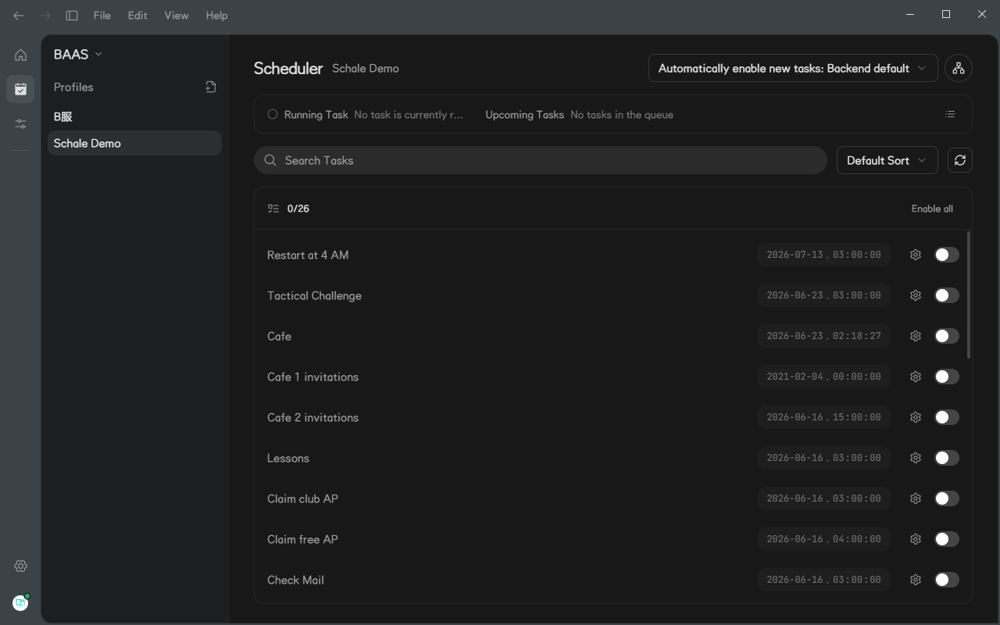
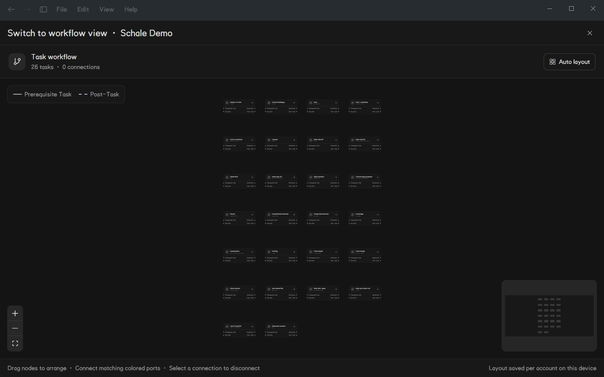
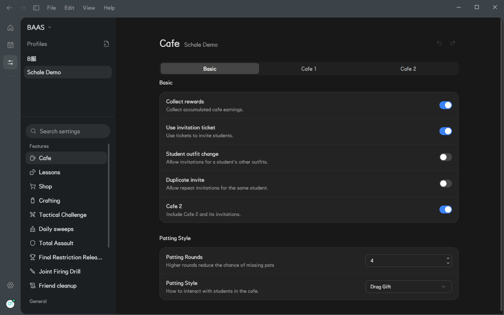
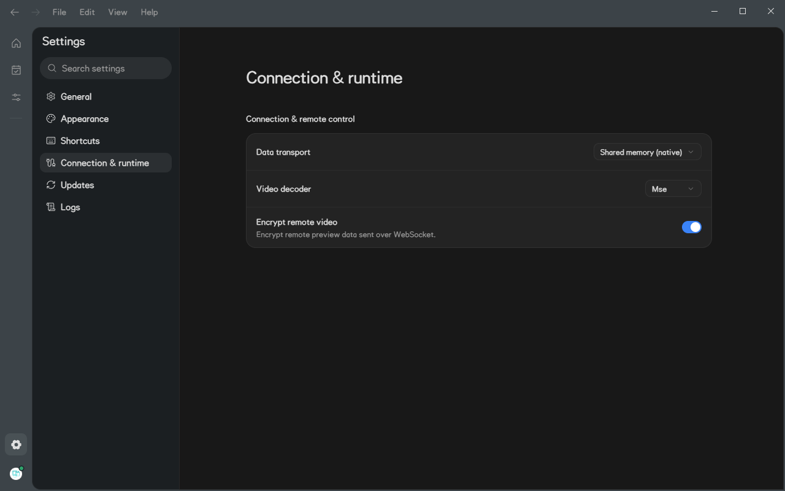
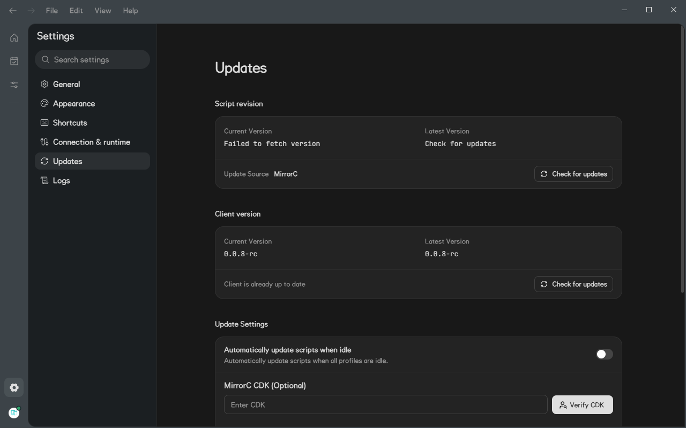

<div align="center">

  

  <h1>BAAS Tauri App</h1>

  <p><strong>Desktop command center for multi-profile Blue Archive automation</strong></p>

  <p>
    
    
    
    
    
  </p>

  <p>
    <a href="README_zh.md"><kbd>Chinese README</kbd></a>
    <a href="https://github.com/Kiramei/baas-tauri/releases/latest"><kbd>Download</kbd></a>
    <a href="https://baas.kiramei.moe/docs/en/"><kbd>Documentation</kbd></a>
    <a href="LICENSE"><kbd>License</kbd></a>
  </p>

</div>



---

## 🚀 Overview

BAAS Tauri is a Windows, macOS and Linux desktop client for [Blue Archive Auto Script](https://github.com/pur1fying/blue_archive_auto_script). It manages profiles, scheduling, feature settings, logs, updates and remote device display. The BAAS backend handles device connections, recognition and task execution.

## 🧩 What It Controls

| Area             | What You Can Do                                                                                                                                    |
| ---------------- | -------------------------------------------------------------------------------------------------------------------------------------------------- |
| 🗂️ Profiles      | Separate accounts, servers, emulator instances, and task strategies.                                                                               |
| ▶️ Home          | Start or stop scheduling, inspect the running task, next task, queue, logs, assets, and remote display.                                            |
| 🗓️ Scheduler     | Enable tasks, edit next run time, search, sort, set intervals, daily reset windows, pre-tasks, and post-tasks.                                     |
| 🧩 Configuration | Configure server, emulator, script, stages, sweeps, teams, cafe, lessons, shop, crafting, combat, maintenance, push, and more.                     |
| 🎛️ Settings      | Tune theme, language, background, UI scale, remote decoder, safe stream, low performance mode, update channel, source, MirrorC CDK, and SHA tests. |
| 📚 Docs          | Open the documentation site in your system's default browser from Help → Documentation.                                                            |

## 🖼️ Screenshots

| Scheduler Workflow | Feature Configuration |
| ------------------ | --------------------- |
|  |  |

| Runtime and Transport | Settings and Updates |
| --------------------- | -------------------- |
|  |  |

## 📥 Download

Installers are published on [GitHub Releases](https://github.com/Kiramei/baas-tauri/releases). Use the latest Release and choose the package that matches your operating system and CPU architecture.

| System                       | Package                                       |
| ---------------------------- | --------------------------------------------- |
| Windows x64                  | `BAAS.Tauri_*_x64-setup.exe`                  |
| Windows ARM64                | `BAAS.Tauri_*_arm64-setup.exe`                |
| Windows x64 fixed WebView2   | `BAAS.Tauri_*_x64_fixed_webview2-setup.exe`   |
| Windows ARM64 fixed WebView2 | `BAAS.Tauri_*_arm64_fixed_webview2-setup.exe` |
| macOS Apple Silicon          | `BAAS.Tauri_*_aarch64.dmg`                    |
| macOS Intel                  | `BAAS.Tauri_*_x64.dmg`                        |
| Linux Debian/Ubuntu          | `BAAS.Tauri_*_amd64.deb` or `*_arm64.deb`     |
| Linux Fedora/RHEL            | `BAAS.Tauri_*_x86_64.rpm` or `*_aarch64.rpm`  |

The documentation site also includes a dynamic download panel that reads the latest GitHub Release and lists direct installer links.

## 📦 Tech Stack

| Category      | Tools                                         | Notes                                                                                |
| ------------- | --------------------------------------------- | ------------------------------------------------------------------------------------ |
| Desktop Shell | Tauri 2, Rust                                 | Native windowing, commands, capabilities, and packaging.                             |
| Frontend      | React 19.2, Vite 8, TypeScript                | Fast UI iteration and typed client code.                                             |
| Styling       | Tailwind CSS 4, CSS variables                 | Dark/light themes, accent color, background image, zoom, and responsive layout.      |
| State & Data  | Zustand, React Context, localStorage          | Profile state, config snapshots, UI preferences, and runtime state.                  |
| Realtime      | Shared memory, Pipe, WebSocket                | Native transport selection depends on the platform; WebUI uses authenticated WebSocket. |
| UX            | Framer Motion, Radix UI, Sonner, lucide-react | Motion, accessible primitives, toast notifications, and icon controls.               |
| Documentation | Fumadocs, Next.js, MDX, Mermaid, Blueaka      | Web docs, diagrams, bilingual content, GitHub Pages deployment, and font subsetting. |

## 📚 Documentation Site

[English documentation](https://baas.kiramei.moe/docs/en/) · [中文文档](https://baas.kiramei.moe/docs/zh/)

The Fumadocs/Next.js site is maintained in [`docs/`](docs/). For a local preview:

```bash
cd docs
bun install --frozen-lockfile
bun run dev
```

| Language | Local URL                        |
| -------- | -------------------------------- |
| Chinese  | `http://localhost:3000/docs/zh/` |
| English  | `http://localhost:3000/docs/en/` |

`bun run build` exports the site to `docs/out`; font subsetting requires Python
with `fonttools` and `brotli`. GitHub Pages publishes from `main`. See
[`docs/README.md`](docs/README.md) for build and validation commands.

Custom deployments can set `VITE_BAAS_DOCS_URL` at build time.
`VITE_BAAS_WIKI_URL` remains the legacy fallback.

## 🛠️ Development

Prerequisites:

- Bun 1.3 or later.
- A Node.js version compatible with the current Vite and Next.js toolchain.
- Rust toolchain and Tauri 2 prerequisites.
- A BAAS backend service for full runtime interaction.

### Quick Start

```bash
bun install --frozen-lockfile

# Development
bun run tauri dev

# Release build
bun run tauri build
```

### Command List

```bash
# Web UI
bun run dev:webui
bun run build:webui

# Tauri frontend assets
bun run dev:tauri
bun run build:tauri

# Full Tauri app
bun run tauri dev
bun run tauri build

# Target-specific Tauri build
bun run tauri dev --target <TARGET>
bun run tauri build --target <TARGET>

# Checks and formatting
bun run lint
bun run format
bun run i18n:check
```

| Command               | Purpose                                           |
| --------------------- | ------------------------------------------------- |
| `bun run dev:webui`   | Start the Vite development server in Web UI mode. |
| `bun run dev:tauri`   | Start the frontend in Tauri mode.                 |
| `bun run build:webui` | Build Web UI assets.                              |
| `bun run build:tauri` | Build Tauri-mode frontend assets.                 |
| `bun run tauri dev`   | Run the full Tauri app in development mode.       |
| `bun run tauri build` | Build the full Tauri app.                         |
| `bun run lint`        | Run ESLint and i18n checks.                       |
| `bun run i18n:check`  | Verify locale key consistency.                    |

## 🧱 Project Layout

```text
baas-tauri/
|-- src/                    # React client
|-- src-tauri/              # Tauri 2 Rust shell, commands, windows, capabilities
|-- public/                 # application assets, fonts and locales
|-- docs/                   # Fumadocs documentation site
|-- scripts/                # packaging, updater, font, and maintenance scripts
`-- .github/workflows/      # release and documentation deployment workflows
```

## Branches and Android

| Branch | Purpose |
| ------ | ------- |
| [`main`](https://github.com/Kiramei/baas-tauri/tree/main) | Release line and published documentation. |
| [`dev`](https://github.com/Kiramei/baas-tauri/tree/dev) | Desktop, WebUI and documentation development. |
| [`android-dev`](https://github.com/Kiramei/baas-tauri/tree/android-dev) | Native Android development. |

The Android implementation is also integrated into `dev`; `android-dev` remains
available for native Android development. The latest debug candidate has scoped
Android 12 ARM64 physical-device validation with root Shizuku: cold game startup
through the mail flow, preview fullscreen entry/return, Activity recreation, and
configuration ZIP round trips. Android 15 shell-mode input, the full gesture
matrix, release builds, and overall performance gains remain unverified. These
results do not establish general compatibility or release acceptance. See
[goals and current status](docs/ANDROID_GOALS_AND_STATUS_20261024.md),
[version-specific validation](docs/ANDROID_RUNTIME_VALIDATION.md), and the
[historical Android handoff](https://github.com/Kiramei/baas-tauri/blob/android-dev/docs/ANDROID_PREVIEW_HANDOFF.md).

## License

Licensed only under the **GNU General Public License v3.0 (GPLv3)**. See [LICENSE](LICENSE).
