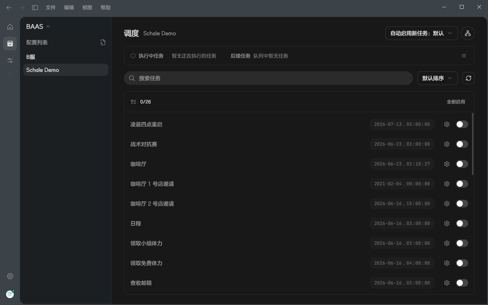
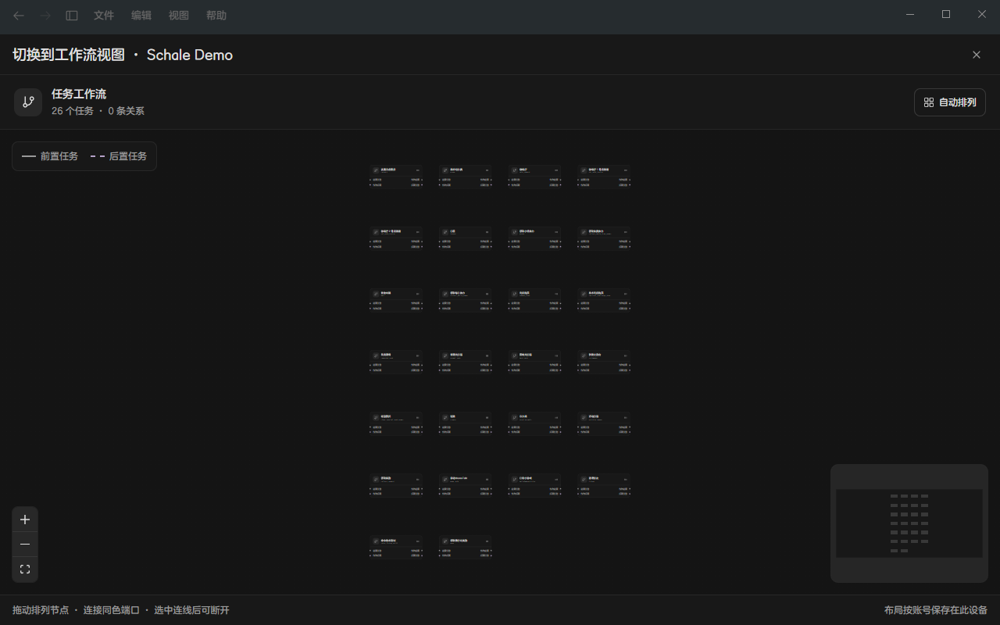
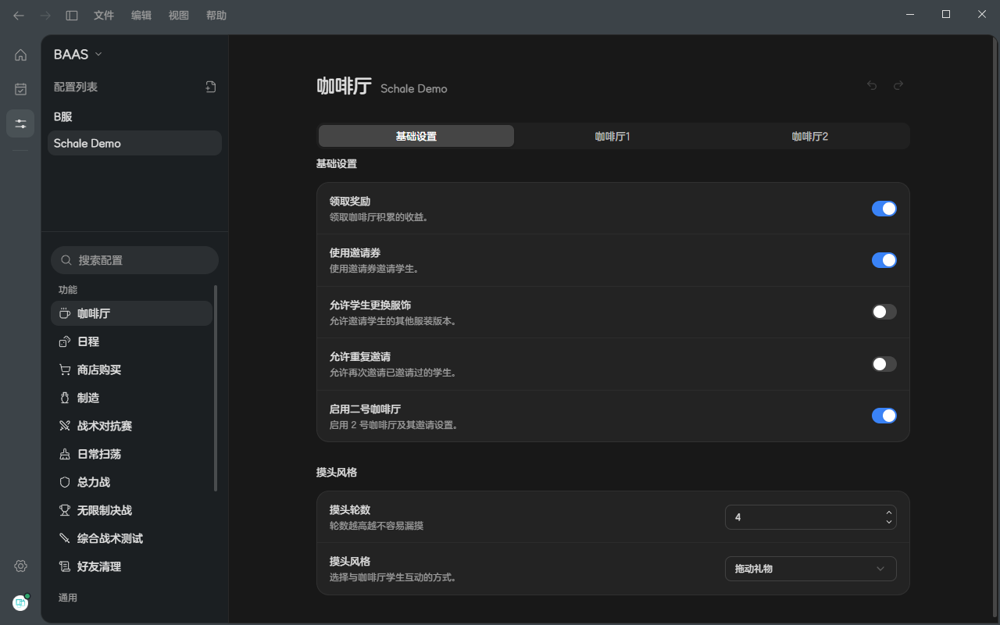
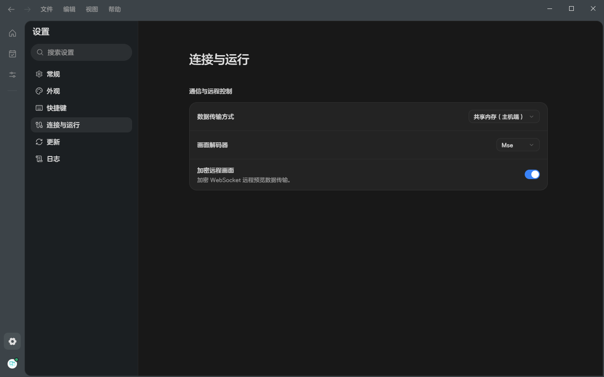
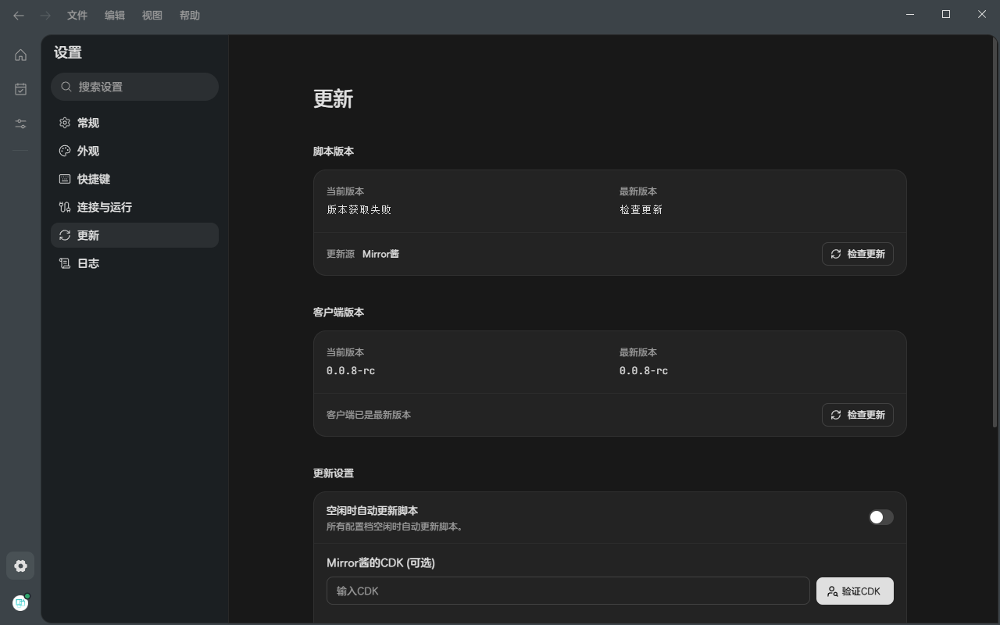

# BAAS Tauri

<p>
  <a href="README.md"><kbd>English README</kbd></a>
  <a href="https://github.com/Kiramei/baas-tauri/releases/latest"><kbd>下载最新版</kbd></a>
  <a href="https://baas.kiramei.moe/docs/zh/"><kbd>文档站</kbd></a>
  <a href="LICENSE"><kbd>GPL-3.0-only</kbd></a>
</p>

BAAS Tauri 是 [Blue Archive Auto Script](https://github.com/pur1fying/blue_archive_auto_script) 的桌面客户端，支持 Windows、macOS 和 Linux。可管理配置档、任务调度、功能配置、日志、更新和远程设备画面，设备连接、识别与任务执行由 BAAS 后端完成。

<p>
  
</p>

## 界面预览



## 🧭 它负责什么

| 区域        | 能做什么                                                                                                     |
| ----------- | ------------------------------------------------------------------------------------------------------------ |
| 🗂️ 配置档   | 隔离账号、区服、模拟器实例和任务策略。                                                                       |
| ▶️ 主页     | 启动/停止调度，查看执行中任务、下一个任务、队列、日志、资产和远程画面。                                      |
| 🗓️ 调度     | 启用任务、编辑下次执行时间、搜索、排序、设置间隔、每日重置、前置任务和后置任务。                             |
| 🧩 功能配置 | 配置服务器、模拟器、脚本、推图、扫荡、编队、咖啡厅、日程、商店、制造、战斗、维护和推送。                     |
| 🎛️ 设置     | 调整主题、语言、背景图、UI 缩放、远程解码器、安全流、低性能模式、更新通道、更新源、MirrorC CDK 和 SHA 测试。 |
| 📚 文档     | 通过标题栏“帮助 → 文档”，使用系统默认浏览器打开文档站。                                                     |

## 🖼️ 截图

| 调度工作流 | 功能配置 |
| ---------- | -------- |
|  |  |

| 运行与连接 | 设置与更新 |
| ---------- | ---------- |
|  |  |

## 📥 下载

安装包发布在 [GitHub Releases](https://github.com/Kiramei/baas-tauri/releases)。下载最新版时，请按你的操作系统和 CPU 架构选择对应文件。

| 系统                        | 安装包                                        |
| --------------------------- | --------------------------------------------- |
| Windows x64                 | `BAAS.Tauri_*_x64-setup.exe`                  |
| Windows ARM64               | `BAAS.Tauri_*_arm64-setup.exe`                |
| Windows x64 固定 WebView2   | `BAAS.Tauri_*_x64_fixed_webview2-setup.exe`   |
| Windows ARM64 固定 WebView2 | `BAAS.Tauri_*_arm64_fixed_webview2-setup.exe` |
| macOS Apple Silicon         | `BAAS.Tauri_*_aarch64.dmg`                    |
| macOS Intel                 | `BAAS.Tauri_*_x64.dmg`                        |
| Linux Debian/Ubuntu         | `BAAS.Tauri_*_amd64.deb` 或 `*_arm64.deb`     |
| Linux Fedora/RHEL           | `BAAS.Tauri_*_x86_64.rpm` 或 `*_aarch64.rpm`  |

文档站中也提供动态下载面板，会读取最新 GitHub Release 并展示可直接下载的安装包。

## 📚 文档站

[中文文档](https://baas.kiramei.moe/docs/zh/) · [English documentation](https://baas.kiramei.moe/docs/en/)

文档站源码位于 [`docs/`](docs/)，使用 Fumadocs 和 Next.js。本地预览：

```bash
cd docs
bun install --frozen-lockfile
bun run dev
```

本地路由：

| 语言    | 地址                             |
| ------- | -------------------------------- |
| 中文    | `http://localhost:3000/docs/zh/` |
| English | `http://localhost:3000/docs/en/` |

`bun run build` 将静态站点导出到 `docs/out`，字体子集构建需要 Python、
`fonttools` 和 `brotli`。GitHub Pages 从 `main` 发布。
构建与校验命令见 [`docs/README.md`](docs/README.md)。

自建部署可在构建时设置 `VITE_BAAS_DOCS_URL`；旧的 `VITE_BAAS_WIKI_URL` 仍作为回退配置保留。

## 🛠️ 开发

前置条件：

- Bun 1.3 或更高版本。
- 与当前 Vite 和 Next.js 工具链兼容的 Node.js。
- Rust 工具链和 Tauri 2 前置依赖。
- 完整运行交互需要 BAAS 后端服务。

```bash
bun install --frozen-lockfile
bun run tauri dev
bun run tauri build
```

| 命令                  | 作用                       |
| --------------------- | -------------------------- |
| `bun run tauri dev`   | 启动完整桌面应用。         |
| `bun run tauri build` | 构建完整桌面应用。         |
| `bun run dev:webui`   | 启动 WebUI 开发服务器。    |
| `bun run build:webui` | 构建 WebUI。               |
| `bun run dev:tauri`   | 以 Tauri 模式启动前端。    |
| `bun run build:tauri` | 构建 Tauri 模式前端资源。  |
| `bun run lint`        | 执行 ESLint 和 i18n 检查。 |
| `bun run i18n:check`  | 检查多语言键一致性。       |

### macOS 本地启动

```bash
bun install --frozen-lockfile
bun run tauri dev
```

`dev:tauri` 只启动前端；`tauri dev` 才启动完整桌面应用。macOS 支持共享内存
和 WebSocket，安装页不提供命名管道；已有的 WebSocket 选择会保留。
Apple Silicon 的托管 Python
明确选择 ARM64；旧的 `3.9.0` 配置使用同系列的可用 ARM64 补丁版本，
Intel Mac 继续选择 x86_64。

生成可以直接打开的本地调试应用（不要求发布签名密钥）：

```bash
bun run tauri build --debug --bundles app --no-sign --config '{"bundle":{"createUpdaterArtifacts":false}}'
open 'target/debug/bundle/macos/BAAS Tauri.app'
```

首次运行需要安装 BAAS 后端和 OCR 资源，之后复用安装目录内的 `.venv`。
连接 Android 手机或模拟器还需要 ADB，可通过
`brew install --cask android-platform-tools` 安装，并用 `adb devices -l` 检查连接。
桌面启动日志位于 `~/Library/Logs/io.github.kiramei.baas-tauri/baas-tauri.jsonl`，
后端日志位于安装目录的 `config/logs/baas-service.jsonl`。

## 🧱 项目结构

```text
baas-tauri/
├─ src/                    # React 客户端
├─ src-tauri/              # Tauri 2 Rust 外壳、命令、窗口和权限
├─ public/locales/         # 应用 UI 多语言文件
├─ docs/                   # Fumadocs 文档站
└─ .github/workflows/      # 发布和文档部署工作流
```

## 分支与 Android

| 分支 | 用途 |
| ---- | ---- |
| [`main`](https://github.com/Kiramei/baas-tauri/tree/main) | 发布版本与线上文档。 |
| [`dev`](https://github.com/Kiramei/baas-tauri/tree/dev) | 桌面端、WebUI 和文档开发。 |
| [`android-dev`](https://github.com/Kiramei/baas-tauri/tree/android-dev) | 原生 Android 开发。 |

Android 实现也已集成到 `dev`，`android-dev` 继续保留用于原生 Android 开发。
最新 debug 候选已在 Android 12 ARM64 真机的 root Shizuku 模式下完成限定验证：
游戏冷启动至邮件流程、预览横屏进入/返回、Activity 重建及配置 ZIP 往返。
Android 15 shell 模式输入、完整手势矩阵、release 构建及整体提速尚未通过验收，
不代表通用兼容或发布验收通过。详见
[目标与当前状态](docs/ANDROID_GOALS_AND_STATUS_20261024.md)、
[各版本验证记录](docs/ANDROID_RUNTIME_VALIDATION.md)与
[历史 Android 交接文档](https://github.com/Kiramei/baas-tauri/blob/android-dev/docs/ANDROID_PREVIEW_HANDOFF.md)。

## 许可证

本项目使用 GPL-3.0-only 协议。详见 [LICENSE](LICENSE)。
