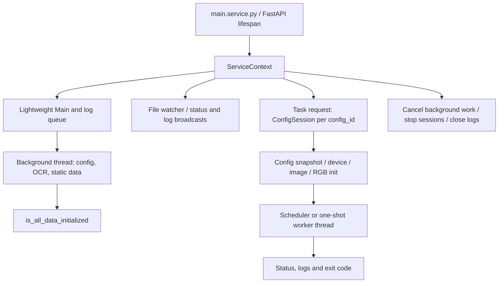

## Environment and Entry Point

Tauri starts `service.app:app` through `main.service.py`. The independent examples
at the bottom of `main.py` can execute game tasks directly. Do not use that file
as the service development command.

The backend's `pyproject.toml` declares Python `>=3.9`. These Windows commands use
Python 3.11, from the root of a separate backend working copy:

```powershell
py -3.11 -m venv .venv
.\.venv\Scripts\python.exe -m pip install -r deploy/service/requirements.service.windows.txt
.\.venv\Scripts\python.exe -m pip install pytest httpx
.\.venv\Scripts\python.exe main.service.py --host 127.0.0.1 --port 8191 --no-ocr-update-check
```

On Linux, use `deploy/service/requirements.service.linux.txt` and
`.venv/bin/python`. Service requirements are separate from the legacy PyQt GUI
requirements. Installing the general `requirements.txt` or default project
dependencies can also install the desktop GUI. The service requirement files
still contain unpinned packages; they are not complete environment locks.

Choose a free port. The default bind address is `0.0.0.0`; explicitly use
`127.0.0.1` for local development. `--no-ocr-update-check` skips only the OCR
update check; service, model and readiness initialization still run. `--reload`
rebuilds service state and is unsuitable for a working copy running game tasks.
`--pipe-name` and `--shm-name` are mutually exclusive and supplied by the
corresponding native transport owner.

Some resources and configuration use relative paths. Keep the process working
directory at the backend root. Use separate profiles and disable autostart,
spending and friend-deletion tasks before attaching a debugger.

## Service Lifecycle



`ServiceContext` owns authentication, configuration, runtime and logging.
Startup first calls `ServiceRuntime.ensure_ready()` to construct a lightweight
`Main`, then initializes OCR and shared data in a background thread. Device,
task and image engines load when a session needs them. Connecting devices,
loading every image or constructing another `Main` at router import time breaks
this lightweight startup and resource ownership.

| Signal | What it establishes |
| ------ | ------------------- |
| `/health` returns `ok` | HTTP is responding; statuses and public authentication metadata are available, without an OCR-readiness guarantee |
| `is_all_data_initialized` | Shared initialization reported success; inspect its logs when diagnosing failures |
| A `ConfigSession` exists | Configuration, signals and status are bound; device initialization may still fail |
| A command returns `started` / `ok` | Acceptance or worker startup; observe later status and logs for task results |

The injected `Main.init_all_data` can continue when `BAAS_ALLOW_MISSING_OCR` is
explicitly enabled. The ready flag alone therefore cannot prove OCR works.
This diagnostic override must not conceal OCR failure in normal OCR-dependent tasks.

Callers should wait for shared readiness before submitting tasks; the flag is
not a universal invocation barrier enforced by every internal API.

## Service Adapters

Read `service/injection.py` alongside the task implementation:

| Stage | Adapted behavior |
| ----- | ---------------- |
| `apply_startup_injections()` | GUI import stubs, structured logging and lightweight `Main`; Android replaces the OCR-client module |
| `apply_service_injections()` | Device/task adapters, Cafe matching, and image, shop, gesture and resource-recognition compatibility layers |

These adapters guard against repeated installation and normally install before
the first task session. Direct unadapted `core` calls can behave differently
from service execution. Tests must identify which path they exercise. For
example, the service's CN image compatibility layer allows bounded movement or
scaling only for listed features, not for every template.

## Sessions, Scheduling and Stop

Each `ConfigSession` holds its `ConfigSet`, `Baas_thread`, worker, signals and
status. A normally retained, still-live worker causes another start request for that profile to
return `already-running`. Device initialization returning `False` or raising
clears partial initialization, reports failure and allows the next start to retry.

Continuous scheduling in `core/scheduler.py` reads `event.json`, filters enabled
and due events outside disabled periods, and orders them by ascending `priority`.
`Baas_thread.thread_starter()` executes pre-tasks, the current task and post-tasks
in that order. It updates the current event's `next_tick` only after the group
succeeds. Relationships are filtered to known task names; graph layout does not
change execution order. Daily resets use UTC; disabled periods use machine-local time.

`solve_task()` uses the same per-profile session for a one-shot task and maps
legacy `start_*` aliases first. `Baas_thread.solve()` dispatches through
`func_dict`; implementations normally return a boolean:

| Path | Handling |
| ---- | -------- |
| Return `False` | Task failure; scheduling stops the current chain |
| `FunctionCallTimeout` / `PackageIncorrect` | Recover and retry, at most three attempts; exhaustion returns failure |
| Other exception while running | Log/push the error and return failure |
| Exception after a stop request | End as human takeover, not normal business completion |

Return `True` or `False` explicitly. Scheduler chains and the one-shot runtime
do not classify `None` identically; an omitted return is not a shared success contract.

Stop sets `flag_run=False` and relies on loops and input boundaries cooperating.
`stop_scheduler()` joins for up to ten seconds before reporting stopped. It does
not forcibly kill a Python thread; a blocked third-party call can still be
unfinished. Preserve stop checks, error propagation and cleanup in new tasks.
After a stop timeout, verify that the old worker has exited before starting the profile again.
Do not hide failure behind unlimited retries.

## Recognition and Control Loop

One `core.picture.co_detect()` iteration follows this order:

1. Acquire a new screenshot, or reuse the cached frame on the first iteration.
2. Check loop timeout and, on Android after a prolonged absence of features, the current package.
3. Wait for loading to finish.
4. Test RGB end features, then image end features; return immediately on a match.
5. Try RGB reactions, then image reactions, in their declared order.
6. If neither matches, call the popup handler; if still unhandled and enabled, accumulate tentative-click failures.

<RecognitionReplay locale="en" />

The replay runs the original `co_detect` and `match_img_feature` functions with
deterministic frame, matcher, clock, loading/popup and input adapters. It shows
branch order and call counts, without running real recognition, device input or
latency measurements. `done`, `ready` and similar names are test features.

| Parameter or rule | Detail |
| ----------------- | ------ |
| `skip_first_screenshot` | Skips only the first capture; the caller must provide a valid cached frame |
| `time_out=600` | Loop limit, not a preemptive deadline for loading waits or blocked calls |
| `check_pkg_interval=20` | Checks the Android package after a sustained absence of features, not on every frame |
| Repeated reaction | Suppresses the same feature at the same coordinates within two seconds; this is not a universal input rate limit |
| Negative coordinates | Counts as a matched reaction without clicking, allowing a state to be awaited |
| `max_fail_cnt=10` | Tentative input begins when failures are **greater than** the limit; a normal reaction match resets the count |
| Tentative wait | Each tentative click sleeps for `screenshot_interval × 5`; do not use this to bypass confirmation dialogs |
| Return value | The RGB name or original image feature; an image-feature tuple is returned as that tuple |

End features should confirm success, not merely the presence of the button
that initiates an action. Do not expect multiple reactions to click from the
same frame: ordering and repeated-click suppression affect execution.

## Screenshots, Coordinates and Input

The base coordinate system is `1280 × 720`, with `ratio = actual_width / 1280`.
Screenshots generally retain their native resolution. Cropping and input apply
the ratio at their own boundaries. `screenshot_cut()` accepts base coordinates;
`img_cut()` accepts actual pixels. Confusing them applies scaling twice.

Image arrays use OpenCV BGR order. RGB feature limits are still declared as
R/G/B and indexed accordingly by `core.color`. Android portrait captures can be
rotated and update resolution. A width-only ratio does not prove correct
positioning on arbitrary aspect ratios; inspect letterboxing, system bars,
orientation and non-16:9 displays separately.

`Screenshot.screenshot()` throttles before the underlying adapter, clamps the
interval to at least 0.3 seconds and updates its timestamp after capture.
A full cycle also includes acquisition and task computation. An adapter's
individual latency therefore does not directly translate into task FPS.

`Baas_thread.click()` adds small coordinate jitter and applies scaling. Nemu
runs synchronously; other common paths start a thread by default.
`wait_over=True` joins that click thread, without proving the game changed pages.
Confirm the next state with a fresh frame. Service Nemu gesture adaptation also
handles explicit duration and release cleanup; do not use unadapted behavior
to explain service measurements. See [Performance](./performance) for timing boundaries.

## Image Resources and OCR

Templates are selected by `identifier`: `CN`, `JP`, `Global_zh-tw`,
`Global_en-us` or `Global_ko-kr`. Modules under
`src/images/<identifier>/x_y_range` declare `prefix`, `path` and `x_y_range`.
The loader combines `prefix_name` and reads its PNG; current-event assets load
separately. Caches are reused by identifier, so replacing a template during
development requires reloading its resources or rebuilding the service.

`compare_image()` checks mean-color difference in the fixed region, resizes it
and uses `TM_CCOEFF_NORMED`; similarity must be **greater than** the threshold.
`search_in_area()` finds the best position in a region and returns base
coordinates or `False`; `ret_max_val=True` returns a pair. The threshold is not
an accuracy percentage. Test positive frames, similar distractors and different
resolutions. Do not lower every threshold to accommodate one button.

`Baas_ocr.get_region_res()` crops the latest cached frame and calls the OCR
client. Single-line output retains characters whose confidence is **greater
than** `filter_score`, default 0.2. `candidates` restricts candidate characters.
Initialization also starts the service, prepares models and tests the required
languages. A successful download cannot establish model readiness.

Desktop-local OCR can use shared memory; remote and Android adapters use image
transfer. This OCR transport is a separate layer from the client's
WebSocket/Pipe/SHM connection to Python. When changing regions, candidate sets or
language, test empty output, low confidence and malformed values. A failed
numeric reading must not silently become a real zero.

## Configuration and New Tasks

| Data | Maintenance location and constraint |
| ---- | ----------------------------------- |
| User defaults | `DEFAULT_CONFIG` in `core/config/default_config.py` |
| User/static types | `generated_user_config.py` and `generated_static_config.py`; keep their keys aligned with defaults |
| Static resources | `STATIC_DEFAULT_CONFIG`; initialization rewrites `config/static.json` |
| Scheduler defaults | `EVENT_DEFAULT_CONFIG`, using stable `func_name` to identify existing tasks |
| Task implementation | `Baas_thread.func_dict` and the corresponding `module` function |
| Service commands | `service/api/commands.py`, runtime aliases, status and failure contracts |
| Client | Types, form validation, sparse patches, task names and translations |

`develop_tools/generate_dataclass_code.py` generates the data classes. Its output
paths are relative to the working directory. Run it from `develop_tools` with
the backend root on Python's import path, then inspect the diff. Updating only
the generated class or only its default JSON can break initialization.

`ConfigInitializer.update_config_reserve_old()` adds missing top-level defaults
and removes keys outside the default set. It does not recursively migrate
existing nested structures. Invalid user JSON is replaced by defaults without
a guaranteed backup. Events merge by `func_name`; `new_event_enable_state`
controls added events, and an invalid event file can reset to defaults.
Back up profiles and test migrations, especially when defaults enable tasks.

`ConfigManager.apply_patch()` modifies a copy, writes it, updates the snapshot
and broadcasts. Stale timestamps or invalid patches return `patch_conflict`
with the current snapshot. An ACK establishes acceptance on the configuration
path, not reconstruction of live device objects or the `Baas_thread.config`
snapshot. Test new dynamic fields in the current session, after reinitialization
and after reconnecting. [Client Architecture](./client-architecture) covers drafts and delayed acknowledgements.

## Logging and Regression Tests

Tasks use `context.logger.info`, `warning`, `error` and `critical`. Service
adaptation queues time, numeric level 1–4 and message; the log manager distributes
them by global/config scope. A level does not stop execution: return failure or
raise explicitly. Service diagnostics separately write
`config/logs/baas-service.jsonl`.

| Numeric level | Method | Purpose |
| ------------- | ------ | ------- |
| 1 | `info` | Progress and normal outcomes |
| 2 | `warning` | Recoverable errors and fallback |
| 3 | `error` | A failed operation |
| 4 | `critical` | Severe initialization or configuration failure |

`logger.line()` retains a compatibility separator; it does not replace status,
return values or exceptions.

Log the stage, target feature, outcome and recovery reason, retaining exception
tracebacks. Do not log passwords, tokens, entire profiles or personal OCR text.

```powershell
.\.venv\Scripts\python.exe -m pytest tests/service tests/core/test_task_retry.py tests/core/ocr -q
```

Cover initialization retry, cooperative stop, command acceptance versus final
exit state, patch conflicts, old-profile migration, image false positives,
coordinate scaling and resource release. Device doubles establish only the
tested contracts. Real devices still need authorization, frames, input effects
and task-result validation. For performance work, preserve equivalent inputs
and outputs and measure initialization, capture, recognition, input waits and
whole-task duration separately.

Source entry points: [service context](https://github.com/Kiramei/baas-dev/blob/d0a86a089068766ff53682b501b90bee99857a71/service/context.py),
[session runtime](https://github.com/Kiramei/baas-dev/blob/d0a86a089068766ff53682b501b90bee99857a71/service/runtime.py),
[service adapters](https://github.com/Kiramei/baas-dev/blob/d0a86a089068766ff53682b501b90bee99857a71/service/injection.py),
[recognition loop](https://github.com/Kiramei/baas-dev/blob/d0a86a089068766ff53682b501b90bee99857a71/core/picture.py),
[configuration initialization](https://github.com/Kiramei/baas-dev/blob/d0a86a089068766ff53682b501b90bee99857a71/service/conf/initializer.py).
