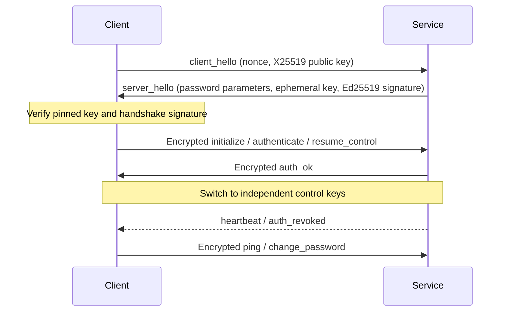
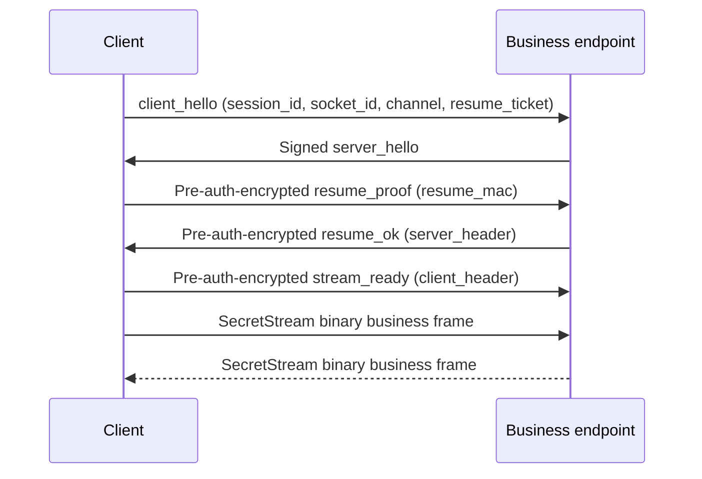

Service separates transport connections, authentication and task execution. A WebSocket client verifies the service and authenticates its control session before opening independent encrypted business streams. Backend status reports whether a scheduler is actually running.

## Entry and Ownership

For local development, bind loopback explicitly rather than inheriting the script's all-interface default:

```bash
python main.service.py --host 127.0.0.1 --port 8190 --log-level info
```

The ASGI entry is `service.app:app`; `service.api.state.context` creates service dependencies lazily. [Backend Development](./backend-development) explains startup, OCR, configuration and task workers. [CLI and Service Mode](./cli-service) lists startup options.

| Module | Responsibility |
| ------ | -------------- |
| `service/api/ws_*.py` | WebSocket authentication, close codes and endpoint entry |
| `service/api/security.py` | Origin checks, control authentication, resume and stream headers |
| `service/auth/` | Password verification, signatures, sessions, tickets, remembered logins and cipher state |
| `service/channels/` | Shared Provider, Sync, Trigger and Remote business handlers |
| `service/transport/` | WebSocket, Pipe and shared-memory endpoints/framing |
| `service/conf/` | Resource paths, snapshots, patches, persistence and broadcasts |
| `src/shared/SecureWebSocket.ts` | Client handshake, password proof and encrypted streams |
| `src/transport/factory.ts` | Platform normalization and adapter selection |

These contracts follow the pinned [client](https://github.com/Kiramei/baas-tauri/blob/55f11ec6f4e0dd2a075e7eead2d16378ad24ae8d/src/shared/SecureWebSocket.ts) and [backend](https://github.com/Kiramei/baas-dev/blob/d0a86a089068766ff53682b501b90bee99857a71/service/api/security.py). Native host command arguments are listed in [Native Client API](./client-api). Check both ends when changing either implementation.

## HTTP and Access Boundaries

| Interface | Behavior and limit |
| --------- | ------------------ |
| `GET /health` | Runtime status, password-initialized flag, `pwd_epoch` and signing public key; no control session required and no proof of game/OCR readiness |
| `POST /auth/remember` | Validate an existing session's `session_id` and HMAC proof, then issue a remembered-login Cookie |
| `POST /auth/logout` | Delete the requesting browser's Cookie; does not revoke every server token or active session |
| `GET /system/logs` | Read diagnostics; requires a loopback request source and clamps `limit` to 1–10000 |
| `POST /system/logs/clear` | Clear diagnostic files; requires a loopback source and changes stored logs |

Some Android compatibility HTTP routes remain in the backend behind Android-environment and loopback checks. Installed adapters can remove old Wiki routes. They are not general remote-control APIs; see the [Android guide](../guide/android) for client operation.

**Do not proxy every HTTP route to the public internet.** Local diagnostic endpoints trust the connection source; a reverse proxy can make an external request appear to come from loopback. Restrict reachable paths and retain independent access controls at the proxy. CORS constrains browser cross-origin behavior.

## Control Authentication

`/ws/control` owns control-session authentication, heartbeats, password changes and revocation notices. The protocol version is `1`.



### Identity and Keys

`client_hello` carries `kind`, `channel`, `version`, `timestamp`, a 32-byte nonce and an ephemeral X25519 public key. The server signs a canonical JSON transcript containing both messages with Ed25519. The client compares `server_sign_pub` with its build-time pin, verifies the signature, then derives directional pre-authentication keys using X25519 and HKDF-SHA256.

The default signing seed is a public, fixed source constant. **It is not an independent identity credential for each remote installation.** For remote deployment, configure a private `BAAS_SERVICE_SIGN_SEED_B64` and build the frontend with the matching `VITE_BAAS_SERVER_SIGN_PUBLIC_KEY_B64`. Never place the private seed in a frontend variable. Replacing only `service_signing_key.bin` is insufficient: without the environment override, the loader restores the default seed to that file.

Application signatures/encryption do not replace HTTPS/WSS. HTTP Cookies, proxy behavior, browser secure contexts and data outside the application cipher stream still need transport-layer protection.

### Initialization, Passwords and Remembered Login

| State | Client request | Server behavior |
| ----- | -------------- | --------------- |
| Password uninitialized | Pre-authentication-encrypted `initialize` containing a password | Reject blank passwords, create a salt/verifier and establish the first session |
| Password initialized | Pre-authentication-encrypted `authenticate` containing `proof` | Verify a handshake-bound HMAC using the Argon2id verifier |
| Browser has a remembered-login Cookie | Pre-authentication-encrypted `resume_control` | Validate the persisted token and create a new control session and secrets |
| Cookie absent or invalid | Same request | Return `resume_unavailable`, then continue waiting for a password request |

First initialization has no pre-existing password proof. Complete it in a controlled local environment before exposing remote access. The service uses a shared system password, not per-user or per-profile authorization; possession of a `config_id` is not a permission boundary.

Default Argon2id parameters are a 32-byte output, 16-byte salt, `opslimit=3` and `memlimit=67108864` bytes. Normal password login sends a proof. Initialization and `change_password` carry the new password inside encrypted messages. Session secrets are derived from the ephemeral shared key, password-derived material and transcript; remembered-login recovery generates fresh secrets on the server.

The password-derived key is reused only within one login when the authenticated salt and every parameter match. A new salt, changed parameters or another login requires derivation again. Never put passwords, derived keys, `masterSecret`, `resumeSecret`, Cookies or complete authentication packets in support logs.

### Persistence and Expiry

| Item | Storage and expiry |
| ---- | ------------------ |
| Active control session | Backend memory; 12-hour default and lost on service restart |
| `resume_ticket` | Server-HMAC session description; resume also requires the in-memory session, so it is not a stateless login token |
| Remembered login | 180-day default, configurable with `BAAS_REMEMBER_TTL_SECONDS`; persisted records store a token hash |
| `baas_remember` Cookie | `HttpOnly`, `SameSite=Lax`, path `/`; `Secure` follows HTTPS by default |
| Password change/reset | Increment `pwd_epoch`, clear active sessions and remembered logins, notify subscribed control connections |

When TLS terminates at a proxy, configure forwarded protocol and Cookie policy correctly. `BAAS_REMEMBER_COOKIE_SECURE` explicitly controls the secure flag; setting it does not provide TLS. `/auth/logout` deletes this browser's Cookie and cannot revoke an already copied token.

A password change prevents old sessions from resuming. The client clears its session and closes business connections after `auth_revoked`. Current business handlers do not recheck `pwd_epoch` on every frame, so this does not guarantee immediate server-forced closure of every already-open stream from an uncooperative client.

## Business-Channel Resume

Provider, Sync, Trigger and Remote each use a separate `/ws/<channel>` connection. They reuse the control session but create new ephemeral keys, nonces and a transcript for each handshake.



`resume_mac` binds the transcript hash, session ID, socket ID, channel and password epoch. The server checks the ticket signature, active session, expiry, epoch and proof; the endpoint also checks that the requested channel matches. `server_header` and `client_header` initialize the two directional XChaCha20-Poly1305 SecretStreams.

Stream keys and AAD also bind session, socket, channel and epoch. Ciphertext from another channel, old connection frames or old stream headers cannot simply be reused. Subsequent JSON travels in binary WebSocket frames; plain `send(JSON.stringify(command))` is not a valid business message.

Control and pre-authentication messages use a ChaCha20-Poly1305 JSON envelope `{type:"secure", seq, ciphertext}`, with sequence-bound nonce and AAD. The Python receiver requires the exact next sequence. The current TypeScript control decoder permits a one-frame gap; do not describe them as identical sequence validators. The client's per-handshake-message wait is 10 seconds, not a uniform server-connection timeout.

## Business Messages

| Channel | Requests and responses |
| ------- | ---------------------- |
| `provider` | Initial `logs_full` and current `status`; later `log`/`status` pushes; accepts `static_request` and `status_request` |
| `sync` | `pull` → `snapshot`; `list` → `config_list`; `patch` → `patch_ack` or `patch_conflict`; also receives change broadcasts |
| `trigger` | `command` → `command_response`, echoing `command` and `timestamp`; some commands append binary data or stream progress |
| `remote` | First encrypted JSON selects `config_id` and `decrypt`, followed by scrcpy video/control proxying |

Provider's `is_all_data_initialized` is an additional runtime gate. Authentication, static resources, profile synchronization and device initialization have separate completion conditions.

### Configuration and Conflicts

Pullable resources are `config`, `event`, `gui`, `static` and `setup_toml`. Frontend patching excludes `static`. Config/event resources use backend profile IDs; display names and array indices are not permanent IDs.

```json
{
  "type": "patch",
  "resource": "config",
  "resource_id": "<profile-id>",
  "timestamp": 0,
  "ops": [{ "op": "replace", "path": "/name", "value": "Example Profile" }]
}
```

The `timestamp: 0` above illustrates the field only. Real requests need the corresponding snapshot timestamp. Supported operations are `add`, `remove` and `replace`, using JSON Pointer paths. An older request is rejected when the current snapshot is already cached; an operation that cannot apply can also produce a conflict.

`patch_conflict` includes `request_timestamp`, current `timestamp`, `data` and an error. The client merges its sparse pending changes and retries at most three times. `patch_ack` echoes the request timestamp, not the new file mtime. Broadcasts carry the actual new snapshot time, `origin` and `direction`. Persistence/acknowledgment are not a multi-client transaction; independently test boundaries such as the first uncached load.

### Commands, Binary Data and Progress

A Trigger request contains `type:"command"`, command name, `timestamp`, optional `config_id` and `payload`. Callbacks correlate by timestamp; check same-millisecond concurrency and stale callback ownership during reconnection. `status:"ok"` can mean only that a scheduler started. Task outcomes still come from Provider.

For `import_config`, `payload.binary=true` means the next message contains ZIP bytes. `export_config` first responds with `data.binary.size`, then sends a binary message. Preserve message order. `test_all_sha_stream` and `update_to_latest_stream` emit multiple responses for one command, ending with `data.done=true`; retain the callback beyond the first progress response.

Remote's `decrypt=false` disables application encryption only for subsequent server binary output. Handshake and client-send paths retain their own encryption rules; authentication is still required. Keep WSS across a network. Preview throughput does not establish automation screenshot/input performance.

## Local Pipe and Shared Memory

Local adapters enter the same `service/channels/` handlers. Their first logical request is `open`, followed by `open_ok`. They do not run the WebSocket password handshake or SecretStream. Their boundary is the managed native process, local IPC permissions and endpoint ownership. Do not forward them onto a network or claim automatic remote encryption.

Pipe uses a 10-byte `BPIP` header: four magic bytes, one version byte, one kind byte and a four-byte little-endian payload length. The per-frame limit is 64 MiB. Kinds `1/2/3/4` mean JSON, bytes, close and error. OS reads can split frames; Python buffers fragments, while the WebView callback decoder expects one complete frame or a complete-frame batch.

WebView → Rust raw invokes use a separate `BPRQ` envelope, not the `BPIP` wire frame. Shared memory adds stream IDs, session ownership, queues and byte budgets; copying Pipe bytes into shared memory is not compatible. See [client recovery](./client-architecture#transport-and-recovery) and the measured [performance scope](./performance).

## Deployment and Diagnostics

| Symptom | Check |
| ------- | ----- |
| Pinned-key mismatch | Both builds must use the same key pair; do not skip signature validation |
| Correct password, failed resume | Password epoch, session expiry, service restart, Cookie origin and security attributes |
| Rejected Origin | WebSocket Origin/Host and `BAAS_SERVICE_ALLOWED_ORIGINS`, independently from HTTP CORS |
| Cross-origin HTTP Cookie unavailable | `BAAS_SERVICE_CORS_ORIGIN_REGEX`, credential mode, browser Cookie policy, HTTPS and forwarded protocol |
| Business connection closes | Prior control authentication, matching channel, new stream headers/sequences, full error and close code |
| Connected but UI not ready | Provider initialization, Sync snapshots, profile list and backend initialization errors |

Origin checks accept an absent Origin, the explicit allowlist, local origins and the same hostname; same-host comparison ignores ports. They do not stop a non-browser client connecting directly. HTTP CORS and WebSocket Origin are separate checks; configuring one does not establish availability or safety of every request.

Typical close codes are `4403` for Origin rejection, `4401` for authentication/protocol errors and `1011` for uncategorized service failures. Inspect the actual close event and logs. Support reports should retain failure stage/type and sanitized profile identifiers, without passwords, Cookies, session secrets or raw authentication packets.
