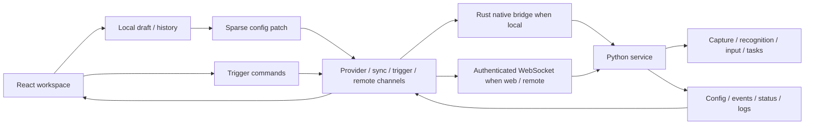

The client is an orchestrator and a view of backend state. A React render does not execute a game task, and a UI setting is not automatically a backend configuration field. Keeping these boundaries explicit makes recovery, multiple profiles and native/mobile differences understandable.

## Ownership Boundaries

`src/store/WebsocketStore.ts` remains the central synchronized store despite its historical name. `src/transport/factory.ts` opens the transport adapter. Business consumers should use the store/channel contracts rather than infer the current transport from that filename.

| Data                                    | Owner and lifetime                           | Why it is separate                                                          |
| --------------------------------------- | -------------------------------------------- | --------------------------------------------------------------------------- |
| Configuration and event definitions     | Backend, keyed by profile                    | The same task behavior must survive client navigation/restart               |
| Current task and waiting queue          | Backend status reports                       | Rendering and sorting cannot decide actual execution                        |
| Incomplete input draft and undo history | Current client window, per profile           | Typing an invalid intermediate value must not corrupt backend configuration |
| Theme, zoom and navigation preferences  | Client storage                               | Presentation changes must not rewrite game task strategy                    |
| Workflow node positions                 | Client storage, keyed by backend and profile | Spatial arrangement is not task order or dependency semantics               |

## Draft, Commit and Acknowledgment

`useConfigurationDraft.ts` registers each editor with `ConfigurationHistory.ts`. Registration takes a snapshot without writing defaults to the backend. Explicit edits change the local draft and schedule a 300 ms flush. Serializers can reject an incomplete draft by returning `null`; only changed serialized keys become a backend patch.

Consecutive edits to the same set of fields are coalesced. A different field/category flushes the previous pending change first. Navigation/hide cleanup flushes pending valid changes. The window keeps at most 100 recorded history steps per profile. Undo/redo restores snapshots and persists the appropriate valid values; it is a data operation, not just changing what the form displays.

Backend synchronization can arrive after a more recent local edit. The history tracks sent patches so an acknowledgment of an earlier value is not mistaken for an external replacement. Sparse acknowledgments can arrive independently per field. A genuinely external update is adopted when the editor is clean and invalidates stale history for that category. This is not a general multi-user conflict-resolution protocol; inspect the source-sync behavior before adding new fields or collaboration features.

## Scheduler Graph Is a View of Existing Events

`src/features/schedulerGraph.ts` derives edges from the backend event array. A pre edge A → B is owned by B and references A in B's `pre_task`; a post edge A → B is owned by A and references B in A's `post_task`. The identical arrow direction does not imply the same owner field.

Before adding an edge, `connectionError` checks port kinds, identity, existence, duplication and reachability back to the source. A reachable path would close a cycle. `relationPatch` edits only the owning relationship list; `taskFieldPatch` emits changed indexed paths such as `3/enabled`, preserving unrelated records and unknown fields. Those indexes are derived from the current array, not assumed to be permanent identifiers.

Layout positions use stable function identifiers and a separate backend/profile storage key. Arranging nodes is a local presentation change. Adding a relationship is a backend configuration change. Task detail dialogs stage their draft until Save, whereas graph relationship and enable operations patch immediately.

## Transport and Recovery

The factory normalizes capabilities before opening channels. WebUI always uses WebSocket. Native Windows/Linux clients can use shared memory when supported; an unavailable shared-memory selection falls back to Pipe. Android does not select desktop shared memory. Explicit supported Pipe/WebSocket choices remain distinct.

Changing transport or recovering a backend restart must replace connection ownership as a unit. Old callbacks can arrive after a new connection is created; generation checks prevent those messages from overwriting the new session. Pending log batches are flushed around disconnect/switch/recovery boundaries. A connected transport alone does not establish that authentication, initial state synchronization and runtime status are all ready.

WebSocket requires an authenticated session bundle. Native local adapters go through Rust commands and their own lifecycle. Do not document native IPC as an encrypted remote WebSocket merely because both expose the same business channel API. Similarly, the remote video channel does not validate the automation's capture and input methods.

## Binary Data and Logs

`src/transport/pipe/protocol.ts` defines the binary envelope used for WebView-to-Rust raw calls. Avoiding a JavaScript number array eliminates JSON byte expansion on that leg. It does not remove OS IPC, Rust/WebView copies or video decoding. Receivers must honor framing, size limits and logical-message boundaries; a callback can contain a single frame or a batch.

`LogBatch.ts` groups history by scope and batches live rows for up to 16 ms or 256 entries. It preserves received rows and within-scope order while reducing repeated store copies/notifications. This is not a drop policy for logs. Status and command responses should not wait for a log timer. Queue retention and backend producer behavior are separate concerns.

The [benchmark page](./performance) measures encoding and state preparation separately. Its raw samples cannot be used to claim a corresponding game FPS or task-completion improvement.

## Android Process and Display Lifecycle

Android adds Kotlin/Java native services and an embedded Python runtime. `MainActivity.kt` starts UI/device integration and schedules the foreground service; the dedicated `:baas_backend` process owns Python and backend ports. Recreating the activity or reloading the WebView should reconnect to that service, not create another Python owner.

Game display, capture and input are a separate privileged pipeline coordinated with Shizuku. The local automation method is `android_local`; desktop ADB/Nemu selectors do not describe this path. Native preview pause/resume/destruction follows activity lifecycle. The existence of a backend `/health` response proves service readiness, not Shizuku authorization, a nonblank game frame or a completed task. Verify those stages independently on the installed device.

## Change Verification

Changes to a shared contract need checks at its boundary: serialized field patches, ordered graph ownership, late acknowledgments, reconnect generations and shutdown/close behavior. A frontend fixture is useful for visual coverage but cannot prove a real backend command or game action. Native screenshots, APK installation, health checks and actual task execution each establish different facts; record their source revision and measurement scope.
