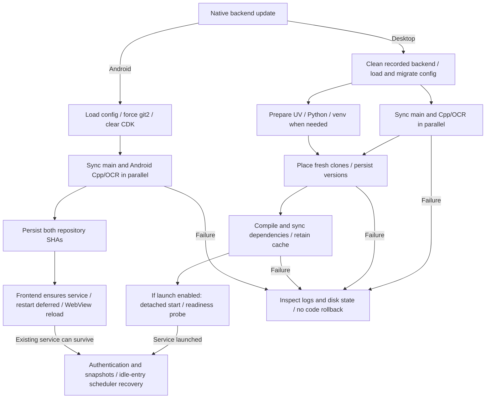

Backend code, the Python environment and client packages update separately. A version check does not install an update, and replaced files still need to be loaded by the service. [Updates](../features/update) covers the UI entry points; [setup.toml](./setup-toml) describes configuration fields.

## Ownership and Entry Points

| Layer | Ownership and completion boundary |
| --- | --- |
| React | Commands, terminal subscriptions, reload and scheduler-state recovery; page reload recreates only the frontend |
| Desktop `UpdaterTermManager` | Workflow threads, Git/UV child processes and transient paths by session; the backend can outlive the task graph |
| Desktop `BackendProcessManager` | Tracks each root's `.baas-updater/backend.pid` for service cleanup; `environ.rs` launches the backend detached |
| Android `AndroidUpdaterTermManager` | Synchronizes the main and Android Cpp/OCR prebuild repositories with git2 and saves SHAs; it does not restart embedded Python |
| Android service and bootstrap | The separate `:baas_backend` process owns Python, loaded modules and service ports; bootstrap prepares files and startup adapters |
| Native client update | Desktop invokes Tauri updater; Android verifies the APK and hands it to the system installer, separately from repository synchronization |

Desktop and WebUI manual sidebar entry sends `stop_all_tasks` and waits for stopped state. Desktop then reloads into native startup; WebUI invokes backend `update_to_latest_stream`. Android's `Sidebar.tsx` branch returns before `stopAllTasks` and directly starts its own workflow. That manual entry contains no task-stop step.

`IdleBackendUpdater.tsx` / `IdleUpdateState.ts` coordinate idle updates. After authentication, profile snapshots and status are ready, a different remote commit is known, and all profiles have remained idle for at least three seconds, they durably save the root and per-profile running flags, then send and await the `stop_all_tasks` response. A continuous scheduler can be idle while still running; a running single-task session is excluded. Failures back off for five minutes, and client updating prevents new idle attempts.

Desktop attempts recorded-backend cleanup at app startup, before updating, during transport startup/authentication reset and on exit. The PID file is shared by installation root; termination checks use a PID and `main.service.py` in the command line, without a process-creation identity token or cross-instance exclusive lock. This provides no exclusive OS process ownership or discovery of every unrecorded service. Workflow-task cancellation and detached-backend cleanup are separate operations.

## Source Selection and Version Probing

| Item | Actual role |
| --- | --- |
| `updateMethod`, `shaMethod` | Backend projections both read/write `general.get_remote_sha_method`; a patch writes `shaMethod` first and `updateMethod` last, so independent persistence is unavailable |
| Native version lookup | Reads local HEAD or a recorded SHA, tries the configured SHA method first, then other usable Git lookup sources; reports the method and remote SHA |
| Native Git transfer | Derives candidate URLs by repository/channel and selects separately through `SourceSelector`; the SHA preference does not pin the download URL |
| Channel and ref | `stable` / `dev` select main-repository source groups, both currently on `master`; Cpp/OCR branches depend on platform/architecture |
| Desktop MirrorC | A nonempty CDK selects archives; `mirrorc_latest_url` ignores its channel argument and requests `stable` |
| Android repository workflow | Forces `git_backend = "git2"`, clears the CDK and uses embedded Python; it installs no desktop UV/venv and uses no MirrorC archive |

`SourceSelector` first reuses a persisted successful URL. Otherwise it races enabled probes and takes the first successful response. Only a successful real operation promotes a source; failures disable sources, and exhaustion re-enables them for up to three complete failed cycles. Records live under `.baas-updater/source-ranking/`: desktop repositories use `main.json` / `cpp.json`, Android uses `android-main.json` / `android-cpp.json`. UV, CPython, PyPI and client packages have separate source records.

Settings SHA connectivity tests produce lookup results without selecting the actual download source. A fast response, equal SHA or preferred-URL record establishes neither archive integrity, installation consistency nor loaded service code. Android's fetch-skip predicate also accepts equality between the recorded and remote SHA; it does not validate local files individually.

## Workflow Stages

This diagram shows the main dependencies and completion boundaries of native backend updating. Manual and idle entry differ in task stopping as described above; bootstrap installation and APK updating have separate flows.

Desktop configuration determines repository targets and validates a nonempty CDK. Main-repository, Cpp/OCR and environment preparation work can overlap. Repository placement and version persistence precede dependency synchronization, so a later failure can leave new code with an old environment. A custom interpreter skips managed environment preparation and dependency sync. `no_update` skips repository synchronization/replacement while environment preparation and launch can continue. Both workflow options and configuration constrain `launch`; disabling it emits no backend-ready event.

Desktop startup requests `/auth/remember`; an HTTP response satisfies that layer's readiness probe. Authentication, profile synchronization, device connectivity and task execution remain separate checks.

Android's repository workflow consists of configuration, two parallel repository tasks and SHA persistence: four tasks in total. After success, both manual and idle entries call `updater_reset_backend_auth_and_restart`. That implementation only ensures the service exists and returns `restarted: false`, `restart_deferred: true`. The following WebView reload can reconnect to the existing Python process. Disk replacement does not unload its imported modules. Activating new code requires an actual backend service-process restart and file load, which this command does not perform.

### Android Service Overlay

At startup, bootstrap also places 14 client-matched files from the APK's backend archive in private `backend-service-overlay` storage. `SERVICE_TRANSPORT_OVERLAY_FILES` lists `service/app.py`, channel implementations, `service/conf/manager.py`, transport endpoints and `service/update/setup_schema.py`. This storage is separate from the installed main repository.

`BAAS_SERVICE_OVERLAY_ROOT` is prepended to `sys.path`. Package paths for `service`, `service.conf` and `service.update` search the overlay before the installation, while package initialization still executes the installation's `__init__.py`. A restarted service can therefore combine APK-matched files with repository files. Updating an external file with the same name does not replace an enabled overlay version. Check the APK version, repository SHA and module `__file__` together when diagnosing activation.

When the APK archive exists, startup rewrites overlay files that differ from it. Without the archive, a complete cached overlay can remain in use; if the cache is incomplete and the installation contains `service/app.py`, this preparation function returns directly. Repository synchronization does not update these APK-matched files, so service changes also require checking the client package.

## Replacement and Cancellation

| Path | Writes and interruption consequences |
| --- | --- |
| Desktop fresh Git clone | Stages first, then moves entries into the destination individually; each colliding destination is deleted separately, with copy-and-delete fallback if rename fails. Interruption can leave mixed or missing content |
| Desktop existing Git repository | Fetches and hard-resets in place to the validated target, overwriting tracked local edits without keeping an old-code backup |
| Desktop MirrorC | Extracts temporarily, then copies into the installation; incremental updates delete, add and modify files in sequence. Success removes `.git` metadata; application edits the live directory |
| Android git2 | Clones at the destination or initializes/fetches/hard-resets in place; missing objects can trigger `.git` rebuilding and retry. Completed writes are not undone |
| Android bootstrap archive | Prepares `.baas-next` inside the root, deletes non-preserved live content, then moves entries individually; there is no whole-directory atomic swap |

Bootstrap preserves existing `.app_storage.json`, `.baas-updater`, `.git`, `config`, `files` and `setup.toml` entries and skips the staging directory itself. A missing backend first uses an archive if present in the APK, then falls back to downloading. When the APK archive changes but the existing backend is Git-managed, bootstrap does not overwrite the repository with that archive. The preservation list provides no backup of other custom files or code rollback.

Desktop abort invalidates the session, terminates registered child processes and sets thread cancellation flags. It can clean transient paths registered for that run. Terminal Git CLI and environment-process paths check cancellation at operation boundaries; synchronous git2 and MirrorC downloading/extraction/copying have no uniform immediate-interruption guarantee. Cleanup does not restore the live directory. Abort cannot undo completed replacement or dependency changes.

Android abort also clears the terminal session and sets task flags, but current `sync_android_repository` / `sync_git2_worktree` receive no cancellation flag, and transfer callbacks do not stop on it. Synchronization already in progress can continue fetching, resetting and writing after the terminal reports stopped. `stoppedTasks` counts registered tasks without proving that all writing threads have ended. Retrying can race writes that remain in progress.

## Trust and Integrity

### Git and Transport

Desktop `GitUpdateGuard` records the old HEAD for mirror updates of the same delivery repository/ref and rejects ancestor rollback or history that cannot establish forward advancement. Shallow history can receive one bounded deeper fetch. Explicit repository/channel/ref changes and rewinds from the canonical upstream still permit history changes. This guard does not cover fresh installations, MirrorC or Android, and supplies no signed-publisher authentication.

Android `fetch_and_reset_git2` points the branch at `FETCH_HEAD` and hard-resets without that ancestry guard, allowing stale mirrors to rewind code. Its certificate callback ignores the certificate argument, returns `CertificateOk` for allowlisted hosts and `CertificatePassthrough` otherwise. A hostname allowlist validates neither the certificate chain nor the certificate holder; logs detecting a system CA directory do not establish that validation. Git object SHAs and remote lookup results do not close this transport-identity gap.

### MirrorC

CDK checks handle server-reported key status, quota and expiry, separately from archive-byte verification. `MirrorLatest.sha256` is parsed into the response structure, but the update path downloads and extracts/applies the archive without computing and comparing its SHA256. It also performs no Minisign verification of backend archives. A valid CDK, readable ZIP and saved version establish neither archive provenance nor integrity. Requests carry the CDK, so logs and reports still require secret handling.

### Android APK

The install command fetches metadata again, requires a remote version newer than the current client, an HTTPS download URL and a nonempty signature, then checks the ZIP/APK header and verifies downloaded bytes with Minisign using the embedded public key. Only after verification does it write the app-private cache and invoke Kotlin `installPackage`. Kotlin checks that the file is in private cache/files storage and hands it to the system installer through FileProvider.

On Android 8 and later, missing permission to install from this app opens authorization settings and returns an error; another update attempt is required after authorization. Once the system installer opens, the command returns success and emits `Finished`, without an installation-result callback. The user can cancel installation there. Closing progress also offers no interface to abort the blocking download. Signature verification establishes package-byte authenticity; a subsequent client launch and version check establish installation and the running version.

## Failure and Recovery

| Failure point | Existing state and recovery boundary |
| --- | --- |
| Configuration, CDK or network selection | Stage logs, root, channel, actual URL and both local/recorded SHAs help locate failure; keys require redaction. Lookup failure cannot establish that installation is current |
| Desktop mirror-history rejection | That rejection leaves the original HEAD unreset and selection can try another source; canonical upstream and channel identity determine guard scope |
| Interrupted replacement, reset or archive application | The directory can be incomplete and version records can lag. Recovery requires complete target code and a compatible environment; staging cleanup, retry notices and profile backups provide no code rollback |
| Environment/dependency failure | Code and saved SHAs can already be updated while the service has not launched; another version lookup cannot repair dependencies |
| Startup, authentication or synchronization | File-stage success and process availability need separate diagnosis. Android additionally distinguishes a surviving old service from a new process loading updated code |
| APK authorization or installation cancellation | Authorization requires retrying the installation request; installer launch proves handoff, and the later running version confirms completion |

Idle recovery records contain only schema, root and per-profile running booleans. If stopping or updating throws, restoration of the original scheduler states is attempted, and the record is cleared only after successful restoration. Reconnection also validates the record before restoring both running and stopped states. Failed restoration can leave the record for another attempt; disabling automatic updates does not remove a valid pending record. Android idle updating waits up to thirty minutes for terminal completion, then requests abort on timeout, subject to the cancellation limits above. The checkpoint contains no old code, dependency snapshot or in-game execution position.

## Source Index

| Scope | Implementation |
| --- | --- |
| Android service overlay | [bootstrap.py: APK-matched files and package search paths](https://github.com/Kiramei/baas-tauri/blob/e3ed51d7339ea33dc5b6a397e1368b0dfee48e19/src-tauri/gen/android/app/src/main/python/android_backend/bootstrap.py#L783-L829) |
| Desktop tasks and cancellation | [workflow.rs: graph and stages](https://github.com/Kiramei/baas-tauri/blob/be186c524ab9f7a91c41582aec3a5fef06614751/crates/baas-updater/src/workflow.rs#L526-L731), [app.rs: abort and registered tasks](https://github.com/Kiramei/baas-tauri/blob/be186c524ab9f7a91c41582aec3a5fef06614751/crates/baas-updater/src/app.rs#L223-L279) |
| Desktop files and versions | [workflow.rs: targets and entry-by-entry moves](https://github.com/Kiramei/baas-tauri/blob/be186c524ab9f7a91c41582aec3a5fef06614751/crates/baas-updater/src/workflow.rs#L258-L441), [version persistence](https://github.com/Kiramei/baas-tauri/blob/be186c524ab9f7a91c41582aec3a5fef06614751/crates/baas-updater/src/workflow.rs#L1237-L1289) |
| Desktop processes | [environ.rs: detached launch and PID path](https://github.com/Kiramei/baas-tauri/blob/be186c524ab9f7a91c41582aec3a5fef06614751/crates/baas-updater/src/environ.rs#L630-L717), [commands.rs: update and restart](https://github.com/Kiramei/baas-tauri/blob/be186c524ab9f7a91c41582aec3a5fef06614751/src-tauri/src/commands.rs#L1018-L1140), [PID cleanup](https://github.com/Kiramei/baas-tauri/blob/be186c524ab9f7a91c41582aec3a5fef06614751/src-tauri/src/commands.rs#L1997-L2067), [lib.rs: startup/exit](https://github.com/Kiramei/baas-tauri/blob/be186c524ab9f7a91c41582aec3a5fef06614751/src-tauri/src/lib.rs#L193-L244) |
| Git source selection and guard | [repo.rs: ancestry checks](https://github.com/Kiramei/baas-tauri/blob/be186c524ab9f7a91c41582aec3a5fef06614751/crates/baas-updater/src/repo.rs#L29-L160), [selection](https://github.com/Kiramei/baas-tauri/blob/be186c524ab9f7a91c41582aec3a5fef06614751/crates/baas-updater/src/repo.rs#L340-L454), [commands.rs: lookup fallback](https://github.com/Kiramei/baas-tauri/blob/be186c524ab9f7a91c41582aec3a5fef06614751/src-tauri/src/commands.rs#L1256-L1286) |
| MirrorC | [mirrorc.rs: download, fixed channel and SHA256 parsing](https://github.com/Kiramei/baas-tauri/blob/be186c524ab9f7a91c41582aec3a5fef06614751/crates/baas-updater/src/mirrorc.rs#L235-L345), [live-directory application](https://github.com/Kiramei/baas-tauri/blob/be186c524ab9f7a91c41582aec3a5fef06614751/crates/baas-updater/src/mirrorc.rs#L389-L488) |
| Android repositories | [android.rs: configuration and sync](https://github.com/Kiramei/baas-tauri/blob/e3ed51d7339ea33dc5b6a397e1368b0dfee48e19/crates/baas-updater/src/android.rs#L439-L745), [hard reset and certificate callback](https://github.com/Kiramei/baas-tauri/blob/e3ed51d7339ea33dc5b6a397e1368b0dfee48e19/crates/baas-updater/src/android.rs#L988-L1092), [abort](https://github.com/Kiramei/baas-tauri/blob/e3ed51d7339ea33dc5b6a397e1368b0dfee48e19/crates/baas-updater/src/android.rs#L251-L307) |
| Android activation and bootstrap | [Sidebar.tsx: manual entry](https://github.com/Kiramei/baas-tauri/blob/e3ed51d7339ea33dc5b6a397e1368b0dfee48e19/src/components/layout/Sidebar.tsx#L202-L290), [mobile_commands.rs: deferred restart](https://github.com/Kiramei/baas-tauri/blob/e3ed51d7339ea33dc5b6a397e1368b0dfee48e19/src-tauri/src/mobile_commands.rs#L2789-L2837), [bootstrap.py: archive entry](https://github.com/Kiramei/baas-tauri/blob/e3ed51d7339ea33dc5b6a397e1368b0dfee48e19/src-tauri/gen/android/app/src/main/python/android_backend/bootstrap.py#L199-L241), [preservation and replacement](https://github.com/Kiramei/baas-tauri/blob/e3ed51d7339ea33dc5b6a397e1368b0dfee48e19/src-tauri/gen/android/app/src/main/python/android_backend/bootstrap.py#L304-L324) |
| Android APK | [mobile_commands.rs: download and verification](https://github.com/Kiramei/baas-tauri/blob/e3ed51d7339ea33dc5b6a397e1368b0dfee48e19/src-tauri/src/mobile_commands.rs#L2538-L2672), [BackendServicePlugin.kt: installer handoff](https://github.com/Kiramei/baas-tauri/blob/e3ed51d7339ea33dc5b6a397e1368b0dfee48e19/src-tauri/gen/android/app/src/main/java/io/github/kiramei/baas_tauri/BackendServicePlugin.kt#L312-L342) |
| Idle and client-update coordination | [IdleBackendUpdater.tsx](https://github.com/Kiramei/baas-tauri/blob/e3ed51d7339ea33dc5b6a397e1368b0dfee48e19/src/components/IdleBackendUpdater.tsx#L43-L183), [IdleUpdateState.ts](https://github.com/Kiramei/baas-tauri/blob/e3ed51d7339ea33dc5b6a397e1368b0dfee48e19/src/shared/IdleUpdateState.ts#L44-L74), [TauriSelfUpdateProvider.tsx](https://github.com/Kiramei/baas-tauri/blob/e3ed51d7339ea33dc5b6a397e1368b0dfee48e19/src/context/TauriSelfUpdateProvider.tsx#L28-L102) |
| Shared settings projection | [service/conf/manager.py: reads](https://github.com/Kiramei/baas-dev/blob/d0a86a089068766ff53682b501b90bee99857a71/service/conf/manager.py#L113-L124), [write order](https://github.com/Kiramei/baas-dev/blob/d0a86a089068766ff53682b501b90bee99857a71/service/conf/manager.py#L212-L233) |
