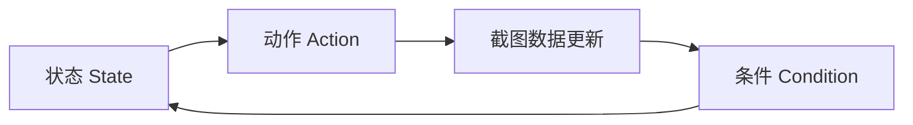
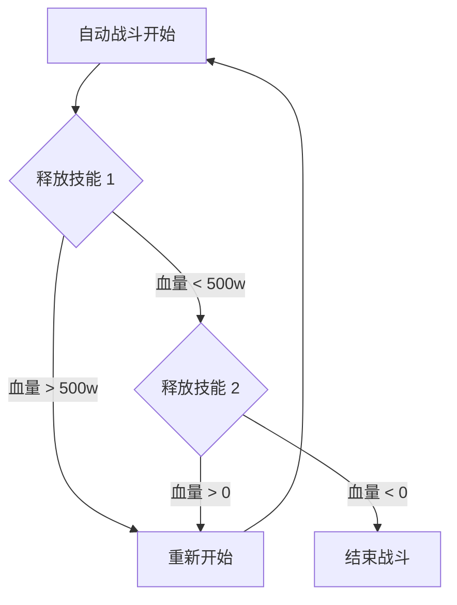
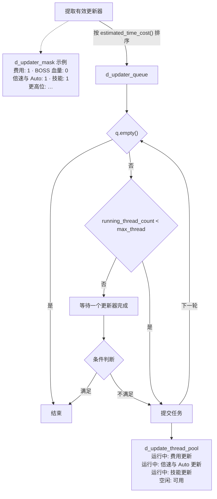

这个页面迁移自旧 `develop_doc/script/auto_fight.md`、`game_feature.md`、`screenshot.md` 和 `ocr.md`，用于理解 BAAS 后端如何从画面中提取状态并执行战斗流程。

<Callout type="warn" title="这是开发参考">
  普通用户只需要在 Tauri 客户端配置任务。这里讨论的是后端自动战斗轴、识别资源和源码维护。
</Callout>

## 自动战斗模型

BAAS 自动战斗按以下流程运行：

1. 持续截图。
2. 从图像中提取费用、技能、血量、时间、角色位置等数据。
3. 按用户定义的“轴”判断条件。
4. 在合适状态释放技能或执行重开、结束等动作。

旧文档把它类比为有限状态自动机：



轴文件是 JSON，核心由三类对象组成：

| 对象        | 作用                                                   |
| ----------- | ------------------------------------------------------ |
| `state`     | 当前处于哪个流程节点，到达状态时执行动作，再按条件转移 |
| `action`    | 释放技能、重开、等待、切换 Auto 等具体操作             |
| `condition` | 血量、费用、技能名、超时、组合条件等判断               |

旧文档用下图展示一条战斗轴示例。图中的 `500w` 表示 500 万血量：



## 可监测的战斗数据

自动战斗从截图中维护一组可被条件和动作读取的数据：

| 数据                     | 用途                           |
| ------------------------ | ------------------------------ |
| BOSS 当前血量 / 最大血量 | 血量轴、斩杀判断、重开判断     |
| 技能槽学生名             | 判断指定学生技能是否出现       |
| 技能费用                 | 判断是否能释放技能             |
| 当前费用                 | 控制释放时机                   |
| 倍速 / Auto 状态         | 确认战斗状态                   |
| 战斗剩余时间             | 超时或阶段判断                 |
| 房间剩余时间             | 总力战等限时场景               |
| 学生和敌人位置           | 目标选择、范围技能和 YOLO 检测 |


下图复现旧文档中的数据更新队列示例。`d_updater_mask` 的每一位对应一个数据更新器，图中启用费用、倍速与 Auto、技能更新，未启用 BOSS 血量更新：



## 截图和控制性能

旧文档给出的截图方式经验值：

| 截图方式            | 特点                                   |
| ------------------- | -------------------------------------- |
| `nemu`              | MuMu 12 场景速度快、无损，推荐优先测试 |
| `scrcpy`            | 速度较快，但不是无损截图               |
| `adb`               | 稳定但较慢                             |
| `uiautomator2`      | 稳定但较慢                             |
| `mss` / `pyautogui` | PC 客户端窗口截图场景                  |

不同设备和模拟器差异很大。自动战斗、远程画面和普通日常任务对截图延迟的敏感度不同，不要把某个任务的最优配置直接套到所有场景。

## 模板匹配

模板匹配适合识别静态图像：按钮、图标、固定 UI 元素、商店入口等。优点是 CPU 上即可毫秒级执行；缺点是对缩放、旋转、色彩和截图比例敏感。

常见函数职责：

| 函数                            | 作用                                     |
| ------------------------------- | ---------------------------------------- |
| `compare_image`                 | 对固定区域和模板做匹配，返回相似度       |
| `search_in_area`                | 在指定区域搜索模板，返回最佳位置和匹配度 |
| `search_image_in_area`          | 使用运行时提供的模板图像做区域搜索       |
| `get_image_all_appear_position` | 返回所有超过阈值的出现位置               |
| `swipe_search_target_str`       | 滑动搜索目标字符串或图像                 |


## OCR

OCR 用于识别文字、数字、血量、费用、活动名或其他无法只靠固定模板稳定判断的信息。旧 OCR 服务支持：

- 多语言模型。
- 单行 OCR。
- 普通 OCR。
- 图像文字框检测。
- 本地图像、远程图像或共享内存传递。

OCR 的代价高于模板匹配。能用稳定模板解决的静态 UI，不应优先使用 OCR；需要读文字、数字或动态内容时再使用 OCR。

```python
if pass_method == 1:
    image_bytes = self.get_image_bytes(origin_image)
    files = {
        "data": (None, json.dumps(data), "application/json"),
        "image": ("image.png", image_bytes, "image/png")
    }
    return requests.post(url, files=files)
```

## 维护识别资源

新增或更新识别资源时，至少确认：

| 项目         | 要求                                   |
| ------------ | -------------------------------------- |
| 分辨率       | 优先采集 16:9 标准画面，推荐 1280x720  |
| 格式         | 使用无损 PNG                           |
| 语言和服务器 | 与目标服务器资源目录一致               |
| 遮挡         | 不要包含鼠标、弹窗、通知遮挡           |
| 命名         | 用语义化名称，不用临时截图名           |
| 验证         | 至少在目标服务器和一个干净配置档中测试 |

如果一个识别失败只发生在 PC 客户端，优先检查 HDR、窗口比例、截图方式和控制方式，而不是直接重采模板。
