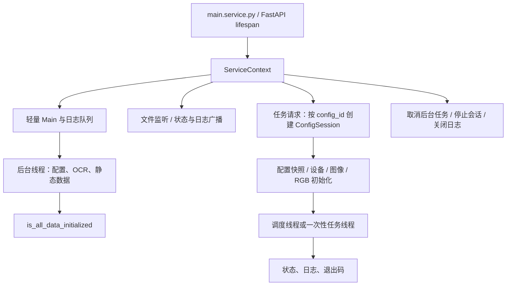

## 开发环境与入口

Tauri 使用 `main.service.py` 启动 `service.app:app`。`main.py` 保留独立运行示例，
文件末尾可能直接执行游戏任务，调试服务时不要将它作为启动命令。

后端 `pyproject.toml` 声明 Python `>=3.9`。以下 Windows 命令使用 Python 3.11，
从一份独立的后端工作副本根目录执行：

```powershell
py -3.11 -m venv .venv
.\.venv\Scripts\python.exe -m pip install -r deploy/service/requirements.service.windows.txt
.\.venv\Scripts\python.exe -m pip install pytest httpx
.\.venv\Scripts\python.exe main.service.py --host 127.0.0.1 --port 8191 --no-ocr-update-check
```

Linux 使用 `deploy/service/requirements.service.linux.txt`，解释器路径为
`.venv/bin/python`。服务依赖与旧 PyQt 界面依赖分开；安装通用 `requirements.txt`
或项目默认依赖可能额外安装桌面 GUI。服务依赖文件仍有未固定版本的包，不能当作完整环境锁。

端口需未被占用。默认绑定地址是 `0.0.0.0`，本地调试显式使用 `127.0.0.1`。
`--no-ocr-update-check` 只跳过 OCR 更新检查，OCR 服务、模型和就绪测试仍需初始化。
`--reload` 仅用于开发，会重建服务状态，不宜与正在执行的游戏任务共用工作副本。
`--pipe-name` 与 `--shm-name` 互斥，由对应本机传输的启动方提供。

资源和部分配置使用相对路径，进程工作目录应为后端根目录。使用独立配置目录，
关闭自动启动及消费、删好友等任务，避免调试器连接到日常运行实例。

## 服务生命周期



`ServiceContext` 持有认证、配置管理、运行时与日志管理器。启动先调用
`ServiceRuntime.ensure_ready()` 创建轻量 `Main`，再在后台线程初始化 OCR 和共享数据。
设备、任务及图像引擎延迟到会话使用时导入。不要在路由模块顶层连接设备、加载全部图像
或创建另一个 `Main`，否则会破坏轻量启动和共享资源归属。

| 状态 | 能说明的事实 |
| ---- | ------------ |
| `/health` 返回 `ok` | HTTP 服务可响应；返回状态和认证公开信息，不含 OCR 就绪保证 |
| `is_all_data_initialized` | 共享初始化路径已报告成功；诊断时仍需核对初始化日志 |
| 创建 `ConfigSession` | 已绑定配置、信号与状态；设备初始化尚可能失败 |
| 命令返回 `started` / `ok` | 请求已接受或工作线程已启动；任务结果需继续看状态与日志 |

服务注入的 `Main.init_all_data` 允许显式设置 `BAAS_ALLOW_MISSING_OCR` 后继续，
因此不能只凭就绪标记认定 OCR 可用。这是诊断开关，不应在依赖 OCR 的正常任务中隐藏失败。

调用方应等待共享就绪后再提交任务；这个标记不构成所有内部 API 的统一调用屏障。

## 服务适配层

阅读任务代码时同时检查 `service/injection.py`：

| 阶段 | 改变的行为 |
| ---- | ---------- |
| `apply_startup_injections()` | GUI 导入占位、结构化日志、轻量 `Main`；Android 替换 OCR 客户端模块 |
| `apply_service_injections()` | 安装设备与任务适配、咖啡厅匹配，以及图像、商店、手势、资源识别兼容层 |

这些适配带有重复安装保护，通常在首次创建任务会话前安装。直接调用未适配的
`core` 对象与通过服务运行，可能得到不同结果。测试应明确覆盖哪条路径。
例如服务的国服图像兼容层仅为列出的特征允许局部位移或缩放，不能推断所有模板都具有这种容差。

## 会话、调度与停止

每个 `ConfigSession` 持有 `ConfigSet`、`Baas_thread`、工作线程、信号和状态。
正常持有的工作线程仍存活时，启动命令返回 `already-running`，不会为同一配置再开一条任务线程。
设备初始化返回 `False` 或抛异常时，运行时清除部分初始化标记、设置失败状态，后续启动重新初始化。

持续调度使用 `core/scheduler.py`：读取 `event.json`，筛选已启用、到期且不在禁用时段的事件，
按 `priority` 升序选择；`Baas_thread.thread_starter()` 依次运行前置、当前和后置任务。
仅在整组成功后更新当前事件的 `next_tick`。前后置引用按已知任务名筛选，
客户端图形排列不会改变该顺序。每日重置按 UTC 计算，禁用时段按机器本地时间检查。

一次性任务通过 `solve_task()` 进入同一配置的会话，`start_*` 兼容别名先映射为实际任务名。
`Baas_thread.solve()` 在 `func_dict` 中查找实现，函数通常返回布尔结果：

| 路径 | 处理 |
| ---- | ---- |
| 返回 `False` | 报告任务失败；调度停止当前执行链 |
| `FunctionCallTimeout` / `PackageIncorrect` | 尝试恢复后重试，最多三次；耗尽返回失败 |
| 普通异常且仍运行 | 记录并推送错误，返回失败 |
| 已请求停止时的异常 | 按人工接管结束，不按正常业务完成理解 |

实现应明确返回 `True` 或 `False`。`None` 在调度链与一次性运行时的失败判定不同，
不能将缺失返回值当作统一成功约定。

停止设置 `flag_run=False`，依赖循环和输入边界协作退出。`stop_scheduler()` 等待线程最多十秒，
随后报告停止；它不强杀 Python 线程，阻塞中的第三方调用仍可能尚未返回。
停止超时后不要立即重新启动同一配置，应先确认旧工作线程已经退出。
新增任务必须保留停止检查、异常传播及清理逻辑，不要以无限重试掩盖失败。

## 识别与控制循环

`core.picture.co_detect()` 的一次迭代按以下顺序执行：

1. 获取新截图，或首轮使用已有截图。
2. 检查循环超时；长时间无特征时，Android 路径检查当前游戏包。
3. 等待加载状态结束。
4. 检查 RGB 结束特征，再检查图像结束特征；命中立即返回。
5. 尝试 RGB 点击规则，再尝试图像点击规则，每类按声明顺序匹配。
6. 都未命中时调用弹窗处理器；仍未处理且允许试探时累计失败次数。

<RecognitionReplay locale="zh" />

回放运行原始 `co_detect` 与 `match_img_feature` 函数，截图、匹配器、时钟、加载和弹窗处理器、
输入接口使用预设结果。它展示分支顺序与调用次数，不执行真实识别或游戏输入，也不测量耗时。
场景中的 `done`、`ready` 等名称是测试特征。

| 参数与规则 | 细节 |
| ---------- | ---- |
| `skip_first_screenshot` | 只跳过第一次截图，调用前必须保证缓存帧有效 |
| `time_out=600` | 循环时间上限；加载等待或阻塞调用不是可抢占的硬截止时间 |
| `check_pkg_interval=20` | Android 长时间无特征时检查包名，不是每帧都检查 |
| 重复点击 | 两秒内同一特征、同一位置不再点击；不等于所有输入统一限速 |
| 负点击坐标 | 规则仍算命中，但不点击，可用于等待状态变化 |
| `max_fail_cnt=10` | 试探在计数**大于**上限后触发；未命中继续累积，正常规则命中才重置 |
| 试探等待 | 每次试探点击后等待 `screenshot_interval × 5`，不能用于绕过确认对话框 |
| 返回值 | 返回命中的 RGB 名称或原始图像特征；图像特征传元组时返回该元组 |

结束特征应表达已确认的成功状态，避免把“按钮存在”误写成“动作已完成”。
不要依赖同一帧同时执行多条点击规则；顺序和两秒抑制都会影响行为。

## 截图、坐标与输入

基础坐标系是 `1280 × 720`，`ratio = 实际宽度 / 1280`。截图通常保留原分辨率；
模板裁剪和点击坐标各自在边界应用比例。`screenshot_cut()` 接收基础坐标，
`img_cut()` 接收实际像素坐标，混用会造成重复缩放。

图像数组使用 OpenCV 的 BGR 顺序，RGB 特征范围仍按 R/G/B 声明，由 `core.color` 转换索引。
Android 竖向截图可能旋转并同步分辨率。单一宽度比例不能证明任意长宽比都能正确定位；
画面留边、系统栏、方向和非 16:9 显示需要单独核对。

`Screenshot.screenshot()` 在底层适配器前节流，间隔下限为 0.3 秒；时间戳在采集结束后更新。
因此该层完整周期还包含采集耗时和任务计算，不能将适配器单次耗时直接换算为任务 FPS。

`Baas_thread.click()` 为坐标添加小范围随机偏移并缩放。Nemu 路径同步执行，其他常见路径
默认另开线程；`wait_over=True` 等待点击线程结束，仍不证明游戏页面已经变化。
下一步应通过新截图确认。服务的 Nemu 手势适配还会处理指定持续时间与抬起清理，
不要用未适配对象的行为解释服务实测。各方式的测量边界见[性能基准](./performance)。

## 图像资源与 OCR

模板按 `identifier` 区分 `CN`、`JP`、`Global_zh-tw`、`Global_en-us` 和
`Global_ko-kr`。`src/images/<identifier>/x_y_range` 模块声明 `prefix`、`path`、
`x_y_range`，加载器组合 `prefix_名称` 并读取对应 PNG；活动资源另按当前活动导入。
缓存按 identifier 复用，开发中替换模板后需重新加载对应资源或重建服务。

`compare_image()` 对固定区域先检查平均颜色差，再缩放并使用
`TM_CCOEFF_NORMED`，相似度需**大于**阈值。`search_in_area()` 在区域内搜索最佳位置，
返回基础坐标或 `False`；`ret_max_val=True` 时返回二元组。阈值不是识别准确率，
还需用命中图、近似干扰图及不同分辨率验证。不要全局降低阈值来迁就单个按钮。

`Baas_ocr.get_region_res()` 裁剪最新缓存帧，转交 OCR 客户端。单行结果按字符置信度
**大于** `filter_score` 过滤，默认 0.2；`candidates` 用于限制候选字符。
初始化还会启动服务、准备模型并测试所需语言，网络更新成功不能替代模型就绪。

本地桌面可使用 OCR 共享内存，远程和 Android 适配使用传图路径；这里的 OCR 传图方式
与客户端到 Python 的 WebSocket/Pipe/SHM 是不同层。修改裁剪区、字符集或识别语言后，
同时验证空文本、低置信度与错误格式，避免把识别失败的数字当作真实零。

## 配置与新增任务

| 数据 | 维护位置与注意事项 |
| ---- | ------------------ |
| 用户默认值 | `core/config/default_config.py` 的 `DEFAULT_CONFIG` |
| 用户与静态类型 | `generated_user_config.py`、`generated_static_config.py`，与默认键保持一致 |
| 静态资源 | `STATIC_DEFAULT_CONFIG`；初始化会重新写 `config/static.json` |
| 调度默认项 | `EVENT_DEFAULT_CONFIG`，以稳定 `func_name` 识别现有任务 |
| 任务实现 | `Baas_thread.func_dict` 与对应 `module` 函数 |
| 服务命令 | `service/api/commands.py` 与运行时别名、状态和失败契约 |
| 客户端 | 类型、表单校验、稀疏补丁、任务名称与翻译 |

数据类由 `develop_tools/generate_dataclass_code.py` 生成。脚本输出路径相对于工作目录，
应从 `develop_tools` 执行，并确保后端根目录在 Python 导入路径中；生成后检查差异。
只修改生成类或只修改默认 JSON 都可能导致初始化失败。

`ConfigInitializer.update_config_reserve_old()` 仅补缺失的顶层默认键，并删除默认集合之外的键，
不递归迁移已有嵌套结构。损坏的用户 JSON 会被默认值替换，不能假定自动保留备份。
事件按 `func_name` 合并，新增事件受 `new_event_enable_state` 控制；异常事件文件可能整体回退默认。
修改迁移规则前先备份并测试旧档，尤其注意默认项可能启用任务。

配置同步通过 `ConfigManager.apply_patch()` 修改副本、写盘、更新快照并广播。
过期时间戳或无效补丁会返回 `patch_conflict` 及当前快照。ACK 说明配置路径已接受修改，
不保证正在运行的设备对象或 `Baas_thread.config` 快照已经重建。新增动态字段要测试
当前会话、重新初始化与重连三条路径。[客户端架构](./client-architecture)说明草稿与延迟确认。

## 日志与回归测试

任务使用 `context.logger` 的 `info`、`warning`、`error`、`critical`；服务适配将时间、
级别 1–4 和消息写入队列，日志管理器按 global/config scope 分发。级别本身不会停止任务，
失败仍需明确返回或抛异常。基础服务诊断另写 `config/logs/baas-service.jsonl`。

| 数字级别 | 方法 | 用途 |
| -------- | ---- | ---- |
| 1 | `info` | 阶段进度与正常结果 |
| 2 | `warning` | 可恢复异常和降级 |
| 3 | `error` | 当前操作失败 |
| 4 | `critical` | 初始化或配置导致的严重失败 |

`logger.line()` 保留兼容分隔输出，不替代结构化状态、返回值或异常。

日志记录阶段、目标特征、结果和恢复原因；异常保留堆栈。不要记录密码、令牌、完整配置或
含个人信息的 OCR 原文。

```powershell
.\.venv\Scripts\python.exe -m pytest tests/service tests/core/test_task_retry.py tests/core/ocr -q
```

优先覆盖初始化失败重试、停止传播、命令返回与最终退出状态、补丁冲突、旧配置迁移、
图像误识别、坐标缩放和资源释放。单元测试中的设备替身只能证明相应契约；
真实设备还需验证授权、画面、输入效果和任务结果。性能变更使用相同输入和输出验证，
分别报告初始化、采集、识别、输入等待及整个任务耗时。

源码入口：[服务上下文](https://github.com/Kiramei/baas-dev/blob/d0a86a089068766ff53682b501b90bee99857a71/service/context.py)、
[会话运行时](https://github.com/Kiramei/baas-dev/blob/d0a86a089068766ff53682b501b90bee99857a71/service/runtime.py)、
[服务适配](https://github.com/Kiramei/baas-dev/blob/d0a86a089068766ff53682b501b90bee99857a71/service/injection.py)、
[识别循环](https://github.com/Kiramei/baas-dev/blob/d0a86a089068766ff53682b501b90bee99857a71/core/picture.py)、
[配置初始化](https://github.com/Kiramei/baas-dev/blob/d0a86a089068766ff53682b501b90bee99857a71/service/conf/initializer.py)。
