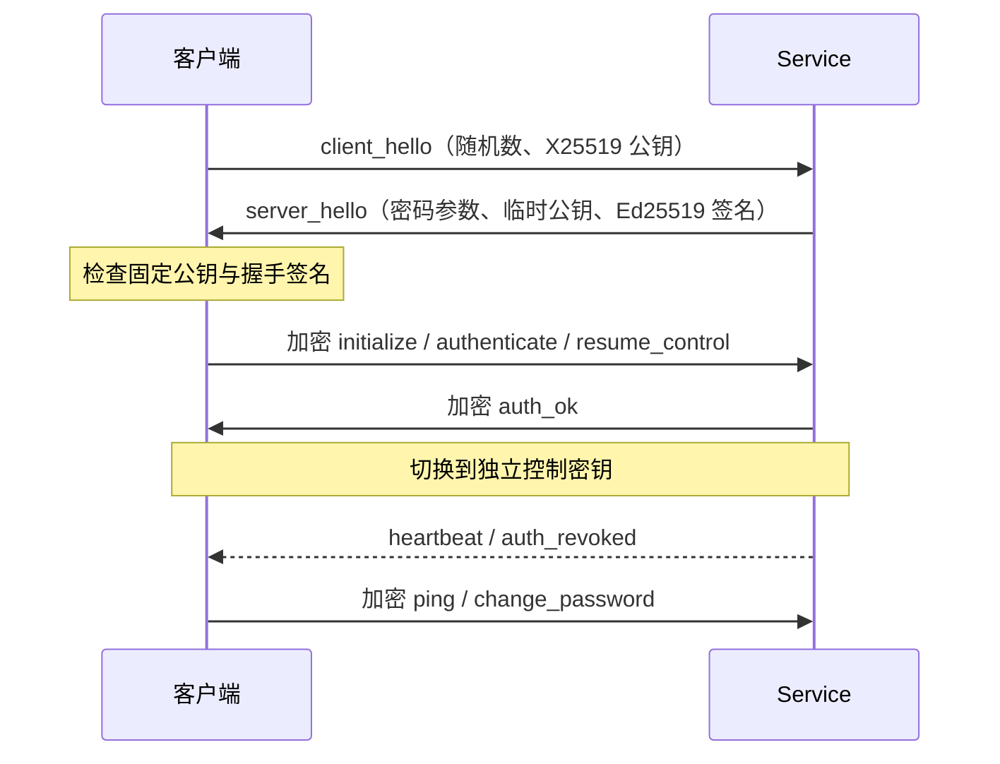
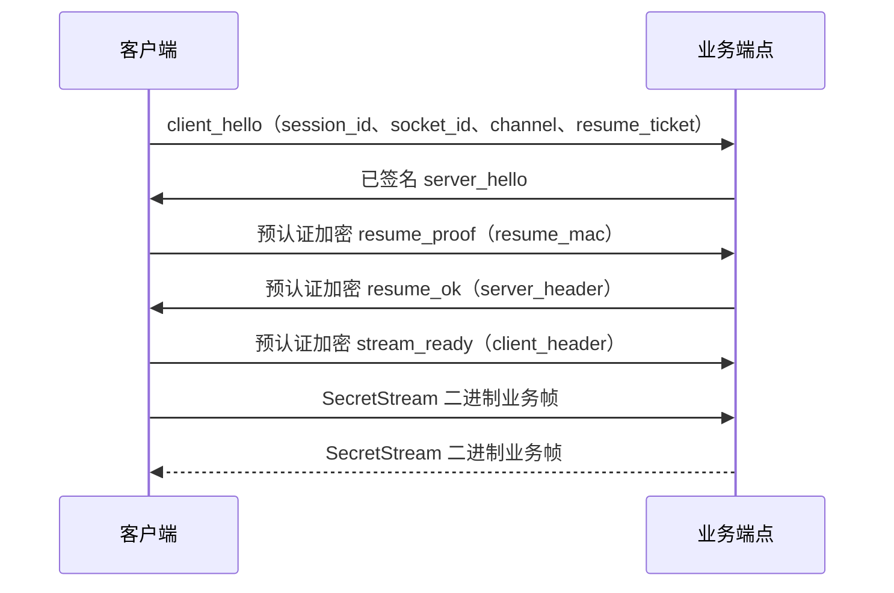

Service 把传输连接、身份认证和任务执行分开。WebSocket 打开后先验证服务身份并完成控制认证，再为各业务通道建立独立加密流；调度是否运行由后端状态报告。

## 入口与模块

本机开发显式绑定回环地址，避免直接采用脚本默认的所有网卡监听：

```bash
python main.service.py --host 127.0.0.1 --port 8190 --log-level info
```

ASGI 入口为 `service.app:app`，`service.api.state.context` 延迟创建服务依赖。启动、OCR、配置初始化与任务线程的关系见[后端开发](./backend-development)，启动参数见[CLI 与 Service 模式](./cli-service)。

| 模块 | 职责 |
| ---- | ---- |
| `service/api/ws_*.py` | WebSocket 认证、关闭码与端点接入 |
| `service/api/security.py` | Origin 检查、控制认证、业务恢复和流头交换 |
| `service/auth/` | 密码验证、签名、会话、票据、记住登录与加密状态 |
| `service/channels/` | Provider、Sync、Trigger、Remote 的共用业务处理器 |
| `service/transport/` | WebSocket、Pipe、共享内存端点和帧封装 |
| `service/conf/` | 资源路径、快照、补丁、文件落盘与变化广播 |
| `src/shared/SecureWebSocket.ts` | 客户端握手、密码证明和加密流 |
| `src/transport/factory.ts` | 平台能力规范化和适配器选择 |

下面的契约依据 [客户端实现](https://github.com/Kiramei/baas-tauri/blob/be186c524ab9f7a91c41582aec3a5fef06614751/src/shared/SecureWebSocket.ts)和[后端实现](https://github.com/Kiramei/baas-dev/blob/d0a86a089068766ff53682b501b90bee99857a71/service/api/security.py)。修改任一端时要同时检查另一端。

## HTTP 与权限边界

| 接口 | 行为与限制 |
| ---- | ---------- |
| `GET /health` | 返回运行状态、密码是否初始化、`pwd_epoch` 与签名公钥；无需控制会话，不证明游戏或 OCR 可用 |
| `POST /auth/remember` | 验证现有会话的 `session_id` 和 HMAC 证明，签发记住登录 Cookie |
| `POST /auth/logout` | 删除调用浏览器的 Cookie；没有撤销服务端所有票据或当前会话 |
| `GET /system/logs` | 读取系统诊断，要求请求来源为回环地址；`limit` 限制为 1–10000 |
| `POST /system/logs/clear` | 清理系统诊断，要求回环来源；会改变日志文件 |

后端还保留部分 Android 兼容路由，受 Android 环境与回环来源检查限制；安装后的适配代码可能移除旧 Wiki 路由。它们不是通用远程控制接口，Android 操作见[客户端指南](../guide/android)。

**不要把全部 HTTP 路由无条件转发到公网。** 本机诊断接口依赖连接来源判断；反向代理可能让外部请求在后端看来来自回环地址。需要在代理层限制可到达的路径，并保留独立访问控制。CORS 只约束浏览器跨源访问行为。

## 控制认证

`/ws/control` 负责建立控制会话、心跳、密码修改与撤销通知。协议版本为 `1`。



### 服务身份与密钥

`client_hello` 携带 `kind`、`channel`、`version`、`timestamp`、32 字节随机数和临时 X25519 公钥。服务端对包含双方消息的规范 JSON transcript 做 Ed25519 签名。客户端先比较 `server_sign_pub` 与编译时固定公钥，再验证签名，随后用 X25519 与 HKDF-SHA256 派生方向独立的预认证密钥。

当前默认签名种子是源码中的公开固定值，**不能作为每台远程服务的独立身份凭据**。远程部署应配置自己的 `BAAS_SERVICE_SIGN_SEED_B64`，并在构建前端时设置匹配的 `VITE_BAAS_SERVER_SIGN_PUBLIC_KEY_B64`。不要把私有种子放入前端变量。只手动替换 `service_signing_key.bin` 也不够：未设置环境变量时，加载器会将该文件恢复为默认种子。

消息签名和应用层加密不替代 HTTPS/WSS。HTTP Cookie、代理行为、浏览器安全上下文和所有未进入应用加密流的数据仍需传输层保护。

### 首次设置、密码登录和记住登录

| 情况 | 客户端请求 | 服务端行为 |
| ---- | ---------- | ---------- |
| 密码未初始化 | 预认证加密的 `initialize`，含密码 | 拒绝空白密码，生成盐和验证值，建立首个会话 |
| 密码已初始化 | 预认证加密的 `authenticate`，含 `proof` | 对照 Argon2id 验证值校验绑定本次握手的 HMAC |
| 浏览器有记住登录 Cookie | 预认证加密的 `resume_control` | 校验持久化令牌，创建新的控制会话和秘密材料 |
| Cookie 缺失或无效 | 同上 | 返回 `resume_unavailable`，继续等待密码请求 |

首次初始化没有预先存在的密码证明，应在受控本机环境完成后再开放远程访问。该服务使用共享系统密码，没有按用户或配置档划分的权限模型；知道 `config_id` 不构成权限隔离。

Argon2id 默认输出 32 字节，盐为 16 字节，`opslimit=3`，`memlimit=67108864` 字节。正常密码登录只发送证明；初始化和 `change_password` 会在加密消息中携带新密码。会话秘密由临时共享密钥、密码派生值及 transcript 绑定派生，记住登录恢复则由服务端生成新的秘密材料。

密码派生值仅在同一次登录中、收到的盐和全部参数完全一致时复用。更换盐、参数或重新登录都需要重新派生。不要将密码、派生值、`masterSecret`、`resumeSecret`、Cookie 或完整握手包写入反馈日志。

### 保存与失效

| 数据 | 存储与失效 |
| ---- | ---------- |
| 活动控制会话 | 后端内存，默认 12 小时；服务重启后丢失 |
| `resume_ticket` | 带服务端 HMAC 的会话描述，恢复时还要求内存会话存在；不是无状态登录令牌 |
| 记住登录 | 默认 180 天，可用 `BAAS_REMEMBER_TTL_SECONDS` 调整；持久化记录保存令牌哈希 |
| `baas_remember` Cookie | `HttpOnly`、`SameSite=Lax`、路径 `/`；默认随 HTTPS 设置 `Secure` |
| 密码修改或重置 | 递增 `pwd_epoch`、清除活动会话和记住登录记录，通知已订阅的控制连接 |

TLS 终止在代理时，要正确配置协议转发和 Cookie 策略；`BAAS_REMEMBER_COOKIE_SECURE` 可以显式设置安全标志。把它设为真不会自动提供 TLS。`/auth/logout` 只删本浏览器 Cookie，不能用于撤销已经复制的令牌。

改密使旧会话无法再次恢复。客户端收到 `auth_revoked` 后会清理会话并关闭业务连接；当前业务处理器没有逐帧重新检查 `pwd_epoch`，因此不能据此保证不合作客户端已经打开的所有业务流都被服务端即时强制关闭。

## 业务通道恢复

Provider、Sync、Trigger、Remote 都需要独立的 `/ws/<channel>` 连接。业务连接使用已有控制会话，但每次握手重新生成临时密钥、随机数和 transcript。



`resume_mac` 绑定 transcript hash、会话 ID、socket ID、通道和密码 epoch。服务端验证票据签名、活动会话、有效期、epoch 和该证明，端点还检查通道名称匹配。`server_header` 与 `client_header` 用于初始化两个方向的 XChaCha20-Poly1305 SecretStream。

流密钥和 AAD 同样绑定会话、socket、通道和 epoch。不能把另一通道的密文、旧连接的帧或旧流头直接搬到新连接。后续 JSON 也通过 WebSocket 二进制帧发送，不能直接调用普通 `send(JSON.stringify(command))`。

控制与预认证帧使用 `{type:"secure", seq, ciphertext}` 的 ChaCha20-Poly1305 JSON 封装，nonce 和 AAD 绑定序号。Python 接收端要求严格下一个序号；当前 TypeScript 控制解码器允许跳过一帧，不能把两者描述成完全相同的序号检查器。客户端单次握手消息等待为 10 秒，这不是整个服务端连接的统一超时。

## 业务消息

| 通道 | 请求与响应 |
| ---- | ---------- |
| `provider` | 建连推送 `logs_full` 和当前 `status`；后续推送 `log`、`status`，接受 `static_request`、`status_request` |
| `sync` | `pull` → `snapshot`；`list` → `config_list`；`patch` → `patch_ack` 或 `patch_conflict`，并接收变化广播 |
| `trigger` | `command` → `command_response`，响应回显 `command` 与 `timestamp`；部分命令追加二进制消息或连续进度响应 |
| `remote` | 首条加密 JSON 选择 `config_id` 和 `decrypt`，随后代理 scrcpy 画面与控制数据 |

Provider 的 `is_all_data_initialized` 是额外的运行时就绪门。认证完成、静态资源到达、配置同步和设备初始化分别有自己的完成条件。

### 配置同步与冲突

可拉取资源为 `config`、`event`、`gui`、`static`、`setup_toml`；`static` 不接受前端 patch。配置与事件使用后端配置档 ID，不能把显示名称或当前数组索引当作永久 ID。

```json
{
  "type": "patch",
  "resource": "config",
  "resource_id": "<profile-id>",
  "timestamp": 0,
  "ops": [{ "op": "replace", "path": "/name", "value": "Example Profile" }]
}
```

这里的 `timestamp: 0` 只是字段示意；真实请求必须使用相应快照时间戳。支持的操作为 `add`、`remove`、`replace`，路径使用 JSON Pointer。当前快照已加载且请求时间戳更旧时会拒绝；操作无法应用也可能产生冲突。

`patch_conflict` 带 `request_timestamp`、最新 `timestamp`、`data` 和错误，客户端据此合并已有稀疏变更并有限重试，最多三次。`patch_ack` 回显请求时间戳，不能当成新文件 mtime；变化广播带实际新快照时间和 `origin`、`direction`。落盘与确认也不构成多客户端事务，首次未缓存加载分支等边界需要独立测试。

### 命令、二进制与进度

Trigger 请求含 `type:"command"`、命令名、`timestamp`、可选 `config_id` 和 `payload`。回调使用时间戳关联；修改客户端时要检查同毫秒并发与重连时旧回调归属。命令返回 `status:"ok"` 可能只表示调度已启动，任务结果仍看 Provider。

`import_config` 的 `payload.binary=true` 表示下一条消息是 ZIP 字节；`export_config` 响应先给 `data.binary.size`，再发二进制。接收端必须保留消息顺序。`test_all_sha_stream` 和 `update_to_latest_stream` 会多次返回同一命令的进度，最后给 `data.done=true`；不要在第一段进度到达时释放回调。

Remote 的 `decrypt=false` 只关闭服务端后续二进制输出的应用层加密；握手与客户端发送路径仍有自己的加密规则。它不等于取消认证。跨网络时即使使用这项设置，也应保留 WSS；画面预览性能不能代替自动化截图/输入性能。

## 本机 Pipe 与共享内存

本机适配器直接进入相同 `service/channels/` 处理器，首个逻辑请求为 `open`，成功返回 `open_ok`。它们不执行上述 WebSocket 密码握手或 SecretStream 流；安全边界在受管理的原生进程、本机 IPC、权限与路径归属。不要把端点转发到网络或宣称它们自动提供远程加密。

Pipe 的 `BPIP` 帧为 10 字节头：4 字节 magic、1 字节版本、1 字节类型、4 字节小端 payload 长度，单帧上限 64 MiB。类型 `1/2/3/4` 分别为 JSON、字节、关闭和错误。操作系统读取可能跨帧分段；Python 解码器缓存片段，WebView 回调解码器则要求完整单帧或完整帧批次。

WebView → Rust 的原始调用使用独立 `BPRQ` 请求封装，不能与 `BPIP` 管道帧混用。共享内存还增加 stream ID、会话归属、队列和流量预算，不能直接把 Pipe 字节写入共享内存并期待兼容。平台选择与恢复见[客户端架构](./client-architecture#传输与恢复)，测量范围见[性能基准](./performance)。

## 部署与排查

| 现象 | 检查 |
| ---- | ---- |
| 固定公钥不匹配 | 前后端构建是否使用同一密钥对；不要跳过签名检查 |
| 密码正确却无法恢复 | 密码 epoch、会话过期、后端是否重启、Cookie 来源与安全属性 |
| Origin 被拒绝 | WebSocket 的 Origin 与 Host、`BAAS_SERVICE_ALLOWED_ORIGINS`；该列表独立于 HTTP CORS 配置 |
| 跨源 HTTP Cookie 不生效 | `BAAS_SERVICE_CORS_ORIGIN_REGEX`、凭据模式、浏览器 Cookie 策略、HTTPS 与代理协议 |
| 业务连接关闭 | 是否先完成控制认证、channel 是否匹配、流头/序号是否复用、完整错误和关闭码 |
| 连接已打开但界面未就绪 | Provider 初始化状态、Sync 快照、配置列表及后端初始化错误 |

Origin 检查接受缺失 Origin、明确允许列表、本机来源和同主机名来源；端口不参与同主机名判断。它不能阻止非浏览器客户端直接连接。HTTP CORS 与 WebSocket Origin 是两套检查，不能只配其中一套就推定所有请求都可用或安全。

常见关闭码为 Origin 拒绝 `4403`、认证/协议错误 `4401`、未归类服务异常 `1011`；以实际关闭事件和日志为准。反馈中保留错误类型、阶段和经过脱敏的配置标识，不附密码、Cookie、会话秘密或原始认证包。
