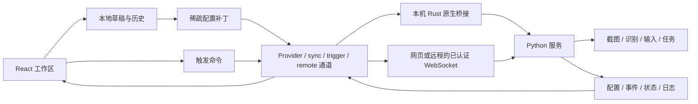

客户端负责协调，并展示后端状态。React 渲染不等于执行游戏任务，界面偏好也不会自动成为后端配置字段。明确这些边界，才能理解恢复、多配置档以及桌面与移动端差异。

## 数据归属

尽管保留历史名称，`src/store/WebsocketStore.ts` 已是统一同步状态仓库；`src/transport/factory.ts` 负责打开实际传输适配器。业务使用方应依据状态仓库和通道契约，而不是根据文件名推断当前使用哪种传输。

| 数据                 | 归属与生命周期                 | 分离原因                               |
| -------------------- | ------------------------------ | -------------------------------------- |
| 配置与事件定义       | 后端，按配置档区分             | 同一任务行为需要跨页面与客户端重启保留 |
| 当前任务与等待队列   | 后端状态报告                   | 渲染与列表排序不能决定真实执行         |
| 未完成输入与撤销历史 | 当前客户端窗口，按配置档区分   | 输入过程中的临时无效值不应损坏后端配置 |
| 主题、缩放与导航偏好 | 客户端存储                     | 展示变化不应改写游戏任务策略           |
| 工作流节点位置       | 客户端存储，按后端和配置档区分 | 空间排列不等于执行顺序或依赖语义       |

## 草稿、提交与确认

`useConfigurationDraft.ts` 将编辑器注册到 `ConfigurationHistory.ts`。注册仅保存快照，不会把默认值写入后端。显式编辑更新本地草稿并安排 300 ms 后刷出。序列化器可以返回 `null` 拒绝未完成的草稿；只有序列化后发生变化的键才进入补丁。

连续修改同一组字段会合并；切换字段或分类前先刷出上一笔待提交变更。导航或隐藏时的清理会刷出有效修改。每个配置档在当前窗口最多记录 100 步历史。撤销与重做恢复快照并持久化相应有效值，因此它们是数据操作，不只是改变表单显示。

后端同步可能晚于更新的本地编辑到达。历史记录追踪已经发送的补丁，避免把较早值的确认误认为外部替换；稀疏确认还可能按字段独立到达。真实外部更新在编辑器无待提交变更时被采纳，并使这个分类的过期历史失效。这不是通用的多人协作冲突解决协议，增加字段或协作功能前需要检查源码同步行为。

## 调度图是事件的视图

`src/features/schedulerGraph.ts` 从后端事件数组生成连线。前置线 A → B 属于 B，把 A 引用保存在 B 的 `pre_task`；后置线 A → B 属于 A，把 B 引用保存在 A 的 `post_task`。相同箭头方向不代表同一个归属字段。

添加连线前，`connectionError` 检查端口类型、任务身份、存在性、重复与反向可达性；已有路径能够回到源节点时，新增边会构成循环。`relationPatch` 仅修改关系归属方的列表；`taskFieldPatch` 只生成变化的索引路径，例如 `3/enabled`，保留无关记录和未知字段。索引来自当前数组，不能当作永久任务标识。

布局使用稳定函数标识，并按后端和配置档独立保存。自动排列属于本地展示变更，添加关系属于后端配置变更。任务详情对话框的草稿保存后才提交；图中的关系与开关则立即发送补丁。

## 传输与恢复

工厂在创建通道前先规范化平台能力。WebUI 始终使用 WebSocket；支持时，原生 Windows/Linux 客户端可以使用共享内存；共享内存选择在不可用的平台回退到 Pipe。Android 不使用桌面共享内存。显式且受支持的 Pipe、WebSocket 选择仍保留其区别。

切换传输或在后端重启后恢复连接时，需要整体替换连接归属。旧回调可能在新连接建立后才到达，连接代次检查避免旧消息覆盖新会话。断开、切换与恢复边界附近会先刷出待显示日志。传输已连接本身不能证明认证、初始状态同步和运行状态都已准备就绪。

WebSocket 要求已认证会话材料，本机适配器经过 Rust 命令和独立生命周期。不能因为二者提供相同业务通道 API，就把本机 IPC 描述成加密远程 WebSocket。远程视频通道同样不能验证自动化使用的截图与输入方式。

## 二进制与日志

`src/transport/pipe/protocol.ts` 定义 WebView 到 Rust 原始调用使用的二进制封装。避免 JavaScript 数字数组可以消除这个阶段的 JSON 字节膨胀，但不会消除操作系统 IPC、Rust/WebView 复制或视频解码。接收端仍需遵守帧格式、大小上限和逻辑消息边界；一次回调可能含单帧或一批帧。

`LogBatch.ts` 将历史日志按 scope 分组，实时日志等待最多 16 ms 或累计 256 条后合批，保留已接收行及各 scope 内顺序，同时减少重复复制和通知。这不是日志丢弃策略，状态与命令响应不应等待日志定时器。队列保留与后端生产策略是另一层问题。

[性能基准](./performance)分别测量编码与状态准备，原始样本不能用来宣称游戏帧率或任务完成时间有对应提升。

## Android 进程与显示生命周期

Android 增加 Kotlin/Java 原生服务与内嵌 Python。`MainActivity.kt` 启动界面、设备集成并安排前台服务；独立 `:baas_backend` 进程拥有 Python 和后端端口。Activity 重建或 WebView 重载应重连服务，而不是创建第二个 Python 所有者。

游戏显示、截图和输入是另一条通过 Shizuku 协调的特权链路。本机自动化方式为 `android_local`，桌面 ADB/Nemu 选择器不代表这条路径。原生预览的暂停、恢复和销毁跟随 Activity 生命周期。后端 `/health` 响应证明服务就绪，不证明 Shizuku 已授权、游戏画面非空或任务已执行完成；这些阶段需要在安装后的设备上独立验证。

## 修改验证

共享契约应在边界验证，包括字段补丁序列化、关系归属与顺序、延迟确认、重连代次，以及停止和关闭行为。前端样例适合做视觉覆盖，但不能证明真实后端命令或游戏操作。原生截图、APK 安装、健康检查和实际任务执行各自证明不同事实，需要记录对应源码提交与测量范围。
