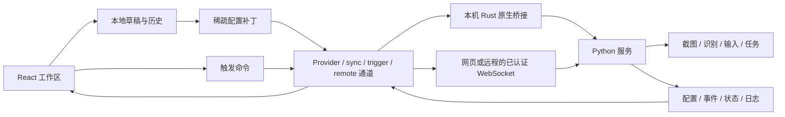
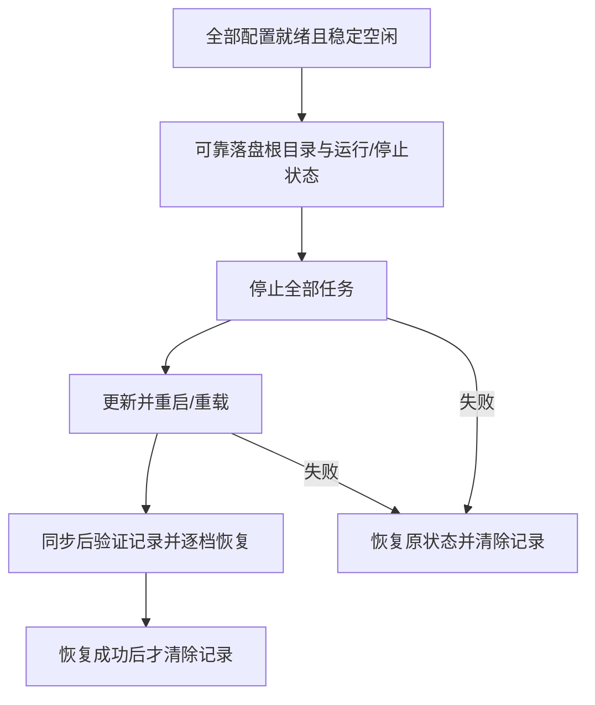
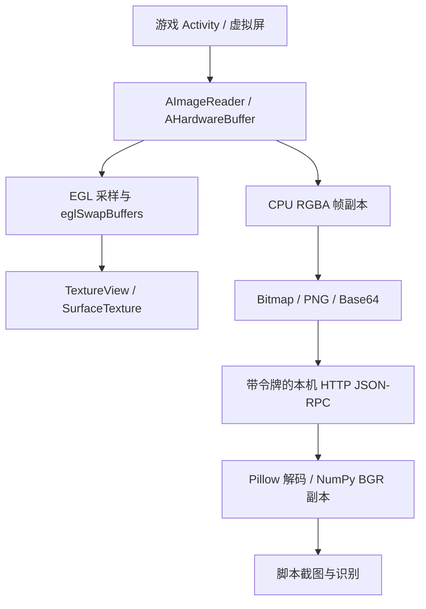

客户端负责协调，并展示后端状态。React 渲染不等于执行游戏任务，界面偏好也不会自动成为后端配置字段。明确这些边界，才能理解恢复、多配置档以及桌面与移动端差异。

## 数据归属

尽管保留历史名称，`src/store/WebsocketStore.ts` 已是统一同步状态仓库；`src/transport/factory.ts` 负责打开实际传输适配器。业务使用方应依据状态仓库和通道契约，而不是根据文件名推断当前使用哪种传输。

| 数据                 | 归属与生命周期                 | 分离原因                               |
| -------------------- | ------------------------------ | -------------------------------------- |
| 配置与事件定义       | 后端，按配置档区分             | 同一任务行为需要跨页面与客户端重启保留 |
| 当前任务与等待队列   | 后端状态报告                   | 渲染与列表排序不能决定真实执行         |
| 未完成输入与撤销历史 | 当前客户端窗口，按配置档区分   | 输入过程中的临时无效值不应损坏后端配置 |
| 主题、缩放与导航偏好 | 客户端存储                     | 展示变化不应改写游戏任务策略           |
| 工作流节点位置       | 客户端存储，按后端和配置档区分 | 空间排列不等于执行顺序或依赖语义       |

## 草稿、提交与确认

`useConfigurationDraft.ts` 将编辑器注册到 `ConfigurationHistory.ts`。注册仅保存快照，不会把默认值写入后端。显式编辑更新本地草稿并安排 300 ms 后刷出。序列化器可以返回 `null` 拒绝未完成的草稿；只有序列化后发生变化的键才进入补丁。

连续修改同一组字段会合并；切换字段或分类前先刷出上一笔待提交变更。导航或隐藏时的清理会刷出有效修改。每个配置档在当前窗口最多记录 100 步历史。撤销与重做恢复快照并持久化相应有效值，因此它们是数据操作，不只是改变表单显示。

后端同步可能晚于更新的本地编辑到达。历史记录追踪已经发送的补丁，避免把较早值的确认误认为外部替换；稀疏确认还可能按字段独立到达。真实外部更新在编辑器无待提交变更时被采纳，并使这个分类的过期历史失效。这不是通用的多人协作冲突解决协议，增加字段或协作功能前需要检查源码同步行为。

## 调度图是事件的视图

`src/features/schedulerGraph.ts` 从后端事件数组生成连线。前置线 A → B 属于 B，把 A 引用保存在 B 的 `pre_task`；后置线 A → B 属于 A，把 B 引用保存在 A 的 `post_task`。相同箭头方向不代表同一个归属字段。

添加连线前，`connectionError` 检查端口类型、任务身份、存在性、重复与反向可达性；已有路径能够回到源节点时，新增边会构成循环。`relationPatch` 仅修改关系归属方的列表；`taskFieldPatch` 只生成变化的索引路径，例如 `3/enabled`，保留无关记录和未知字段。索引来自当前数组，不能当作永久任务标识。

布局使用稳定函数标识，并按后端和配置档独立保存。自动排列属于本地展示变更，添加关系属于后端配置变更。任务详情对话框的草稿保存后才提交；图中的关系与开关则立即发送补丁。

## 传输与恢复

工厂在创建通道前先规范化平台能力。WebUI 始终使用 WebSocket；支持时，原生 Windows/Linux 客户端可以使用共享内存；共享内存选择在不可用的平台回退到 Pipe。Android 不使用桌面共享内存。显式且受支持的 Pipe、WebSocket 选择仍保留其区别。

切换传输或在后端重启后恢复连接时，需要整体替换连接归属。旧回调可能在新连接建立后才到达，连接代次检查避免旧消息覆盖新会话。断开、切换与恢复边界附近会先刷出待显示日志。传输已连接本身不能证明认证、初始状态同步和运行状态都已准备就绪。

WebSocket 要求已认证会话材料，本机适配器经过 Rust 命令和独立生命周期。不能因为二者提供相同业务通道 API，就把本机 IPC 描述成加密远程 WebSocket。远程视频通道同样不能验证自动化使用的截图与输入方式。

## 二进制与日志

`src/transport/pipe/protocol.ts` 定义 WebView 到 Rust 原始调用使用的二进制封装。避免 JavaScript 数字数组可以消除这个阶段的 JSON 字节膨胀，但不会消除操作系统 IPC、Rust/WebView 复制或视频解码。接收端仍需遵守帧格式、大小上限和逻辑消息边界；一次回调可能含单帧或一批帧。

`LogBatch.ts` 将历史日志按 scope 分组，实时日志等待最多 16 ms 或累计 256 条后合批，保留已接收行及各 scope 内顺序，同时减少重复复制和通知。这不是日志丢弃策略，状态与命令响应不应等待日志定时器。队列保留与后端生产策略是另一层问题。

[性能基准](./performance)分别测量编码与状态准备，原始样本不能用来宣称游戏帧率或任务完成时间有对应提升。

## 偏好不是配置档事务

`UISettingsProvider.tsx` 持有单个客户端存储，通过窄订阅通知消费者，并以 150 ms 批次持久化。外观修改立即通知，再落盘，页面隐藏/释放时刷新待写数据；这不是配置档 300 ms 序列化草稿和撤销机制。传输与更新设置还跨越原生/后端边界，出现在设置页并不意味着只是视觉偏好。

保存规则由动作所有者决定：应用内绑定提交合法输入，全局操作系统快捷键保留弹窗草稿直到注册成功，远程视频参数有明确应用命令。当前远控应用闭包读取上一份偏好快照，重建预览才会按新值建立播放器；把已有画布在缩略图与弹窗间移动不会重连。控件显示、偏好落盘、设备命令成功是三件事。

## 配置压缩包与身份

| 命令            | 身份与存储行为                                                |
| --------------- | ------------------------------------------------------------- |
| `add_config`    | 后端创建新 ID，UI 等待初始化数据后选择                        |
| `copy_config`   | 复制目录到新 ID，并产生唯一 `_copy` 名称                      |
| `export_config` | 返回配置目录所有文件的二进制 ZIP，不是客户端偏好备份          |
| `import_config` | 解压到新 ID、初始化受支持默认值，再删除与导入名相同的已有目录 |
| `remove_config` | 移除后端配置档，不在编辑器撤销历史中                          |

核验导入器拒绝非法 ZIP/JSON、父目录穿越和绝对路径条目，接受根目录或一个共同前缀目录下的 `config.json`。这些检查不构成原子替换事务，也不能保证防住所有恶意压缩包，尤其同名替换没有额外前端覆盖确认。多包依次导入，后续失败不撤销前面的成功。以后修改应测试名字冲突、部分解压/初始化失败、运行会话归属和恢复，而不仅是成功上传提示。操作真实数据前先看[配置档](../features/profile)。

## 更新器与后端进程归属

桌面 `UpdaterTermManager` 按会话管理更新工作流中的线程和 Git/UV 子进程。后端由 `environ.rs` 分离启动，以后端根目录下 `.baas-updater/backend.pid` 记录 PID，再由 `BackendProcessManager` 跟踪根目录并清理。工作流完成或取消与后端存活有不同归属；启动、更新前和退出时的清理依赖 PID 文件及命令行检查，没有提供跨客户端实例的操作系统级独占所有权。

Android 的 `AndroidUpdaterTermManager` 同步磁盘仓库，内嵌 Python 属于独立 `:baas_backend` 服务进程。侧栏手动更新在 `stopAllTasks` 之前分支并返回；同步后的 `updater_reset_backend_auth_and_restart` 返回 `restarted: false`、`restart_deferred: true`，WebView 重载继续连接原服务，不能替换已加载的 Python。空闲路径会先保存状态并停止任务，但同样存在延迟重启边界。阶段、取消限制、非原子替换和恢复详见[更新器内部机制](./updater-internals)。

服务启动还可启用 APK 匹配的 `backend-service-overlay`，通过包搜索顺序覆盖部分 `service` 文件。重新启动进程后仍需核对模块来源；单个仓库 SHA 不能描述所有运行中的服务文件。

## 空闲更新是恢复协议

`IdleBackendUpdater.tsx` 与 `IdleUpdateState.ts` 区分空闲和停止：先要求配置同步与后端状态就绪。无当前任务/队列可以同时存在运行中的持续调度器，但运行中的一次性任务会排除；稳定空闲窗口避免把启动时短暂空队列当成更新许可。

保存恢复记录失败不能触动任务。记录带版本与后端根目录身份，避免恢复到不相关配置；不只恢复运行档，也恢复停止档，防止默认值意外启动原本停止的工作。即使用户之后关闭自动更新，有效待恢复记录也仍处理：开关控制新尝试，不是抹除恢复义务。这只恢复调度状态，不是精确接回战斗指令/帧，也不是游戏与文件系统之间的分布式事务。

图中的“重启/重载”取决于平台入口，Android 当前可仅重载 WebView。恢复成功确认调度命令已完成，不能证明新代码已在新服务进程中加载；记录也不保存旧代码供回滚。

## 诊断快照边界

任务日志批处理保留收到的行，系统诊断则有独立保留策略。`SystemLogService.ts` 收集前端/原生/Python 来源，合并去重、按时间排序，最多保留 4,000 行；前端内存为 1,500 条，消息文本可在 24,000 字符截断。来源失败与其他数据一起报告，不能据此认定该来源没有错误。

系统查看器按采集快照筛选复制/导出，清空却在确认后作用于全部配置的诊断来源；自动刷新和跟随末尾也是独立状态。反馈时保留这些区别：筛选导出既不是完整后端日志目录，也不是事件完整送达的证明。用户控件见[系统设置](../features/system#日志)。

## Android 进程与显示生命周期

Android 增加 Kotlin/Java 原生服务与内嵌 Python。`MainActivity.kt` 启动界面、设备集成并安排前台服务；独立 `:baas_backend` 进程拥有 Python 和后端端口。Activity 重建或 WebView 重载应重连服务，而不是创建第二个 Python 所有者。

游戏显示、截图和输入是另一条通过 Shizuku 协调的特权链路。本机自动化方式为 `android_local`，桌面 ADB/Nemu 选择器不代表这条路径。原生预览的暂停、恢复和销毁跟随 Activity 生命周期。后端 `/health` 响应证明服务就绪，不证明 Shizuku 已授权、游戏画面非空或任务已执行完成；这些阶段需要在安装后的设备上独立验证。

## Android 原生预览与截图

预览和脚本截图共用虚拟屏采集源，之后分成两条路径：

以实测 APK 对应的[原生采集实现](https://github.com/Kiramei/baas-tauri/blob/36f08fd35535dccf80b4c51c56da8d33b4201823/src-tauri/gen/android/app/src/main/cpp/display_capture.cpp#L95-L172)为准：预览从硬件缓冲区进入 EGL，不经过 PNG/Base64 或 WebView 视频解码器。但采集回调仍为截图维护 CPU 帧副本，因此不能把整个采集链路称为零复制。渲染器保留当前图像，替换预览 Surface 后可再次提交同一图像；一次成功的 GPU 提交并不证明新游戏帧已显示。

[进度检查](https://github.com/Kiramei/baas-tauri/blob/36f08fd35535dccf80b4c51c56da8d33b4201823/src-tauri/gen/android/app/src/main/java/io/github/kiramei/baas_tauri/PreviewFrameProgress.kt#L5-L52)分别观察三个计数；消费端由 [TextureView 回调](https://github.com/Kiramei/baas-tauri/blob/36f08fd35535dccf80b4c51c56da8d33b4201823/src-tauri/gen/android/app/src/main/java/io/github/kiramei/baas_tauri/NativeGamePreview.kt#L91-L93)记录：

| 计数 | 增长条件 | 单独不能证明 |
| ---- | -------- | ------------ |
| `capturedFrames` | 采集回调成功发布 CPU 帧副本 | GPU 已提交或屏幕已消费 |
| `presentedFrames` | `eglSwapBuffers` 成功 | TextureView 已消费该缓冲区 |
| `displayedFrames` | 可见、未暂停且已连接时，TextureView 回调收到不同的正时间戳 | 像素变化、游戏逻辑前进或任务成功 |

三个计数都大于零后，按[内容检测阈值](https://github.com/Kiramei/baas-tauri/blob/36f08fd35535dccf80b4c51c56da8d33b4201823/src-tauri/gen/android/app/src/main/cpp/frame_content.h#L6-L12)判断黑屏：至少一个像素的 RGB 通道大于 8 才算有内容。内容存在且三个计数各在最近约 2 秒内增长，才显示实时。首次观察到正计数不等于观察到增长。任一计数回退会重置进度历史，避免把旧 Surface/会话的进度用于新会话。静止游戏画面也可能被标为画面未更新，判断故障还要结合当时是否应有动画。

采集计数前进而提交计数停止时，检查预览 Surface、EGL 和 Activity 生命周期；提交前进而消费停止时，检查 TextureView 可见性、连接与时间戳。三个计数都停止时，继续核对游戏 Activity 的显示归属、进程和采集错误。计数不能区分所有根因；不要据此自动重启游戏或扩大权限。

[Python 适配器](https://github.com/Kiramei/baas-tauri/blob/36f08fd35535dccf80b4c51c56da8d33b4201823/src-tauri/gen/android/app/src/main/python/android_backend/native_device.py#L16-L66)读取本机令牌，经设备回环桥接请求 PNG，解码成 BGR 数组。请求可返回最近缓存帧，不等待下一次游戏绘制。[截图基准](./performance#android-本机截图)包含这条调用路径；预览帧率、输入 API 返回和截图确认分别需要独立的计时终点。

## 修改验证

共享契约应在边界验证，包括字段补丁序列化、关系归属与顺序、延迟确认、重连代次，以及停止和关闭行为。前端样例适合做视觉覆盖，但不能证明真实后端命令或游戏操作。原生截图、APK 安装、健康检查和实际任务执行各自证明不同事实，需要记录对应源码提交与测量范围。
