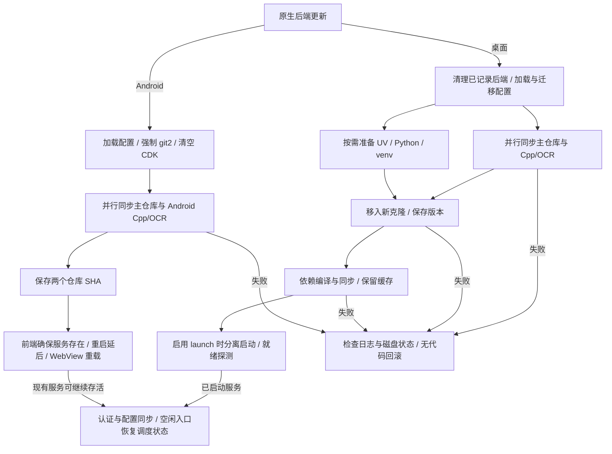

后端代码、Python 环境和客户端安装包分别更新。查询版本不会安装更新，磁盘文件替换后还需确认服务重新加载了代码。[更新指南](../features/update)介绍界面入口，[setup.toml](./setup-toml)记录配置字段。

## 归属与入口

| 层 | 归属与完成边界 |
| --- | --- |
| React | 触发命令、订阅终端事件、重载与调度状态恢复；页面重载只重建前端 |
| 桌面 `UpdaterTermManager` | 按会话管理更新线程、Git/UV 子进程和临时路径；任务图完成后后端仍可存活 |
| 桌面 `BackendProcessManager` | 跟踪后端根目录的 `.baas-updater/backend.pid`，负责服务清理；后端由 `environ.rs` 分离启动 |
| Android `AndroidUpdaterTermManager` | 使用 git2 同步主仓库和 Android Cpp/OCR 预编译仓库，保存 SHA；不承担内嵌 Python 的进程重启 |
| Android 服务与 bootstrap | 独立 `:baas_backend` 进程持有 Python、已加载模块和服务端口；bootstrap 准备文件及启动适配 |
| 原生客户端更新 | 桌面调用 Tauri updater；Android 验签 APK 后交给系统安装器，和后端仓库同步分开 |

桌面与 WebUI 的侧栏手动入口发送 `stop_all_tasks` 并等待停止状态；桌面随后重载进入原生启动工作流，WebUI 发起后端 `update_to_latest_stream`。Android `Sidebar.tsx` 的分支在 `stopAllTasks` 之前返回，直接运行 Android 工作流；手动入口本身没有停止任务这一步。

空闲更新由 `IdleBackendUpdater.tsx` / `IdleUpdateState.ts` 协调：认证、配置快照和状态就绪，已知远端提交不同，至少三秒稳定空闲后，可靠保存根目录与每档运行标志，再发送并等待 `stop_all_tasks` 响应。持续调度器可以空闲且仍为运行状态；运行中的一次性任务被排除。失败退避五分钟，客户端更新期间不发起新的空闲更新。

桌面在应用启动、开始更新、传输启动/认证重置和退出时尝试清理已记录后端。PID 文件按安装根目录共享，终止检查依赖 PID 和命令行中的 `main.service.py`，没有进程创建身份令牌或跨实例独占锁。这不能保证独占操作系统进程所有权，也不能保证发现所有未记录的服务。工作流任务取消与分离后端清理分别处理。

## 选源与版本探测

| 项目 | 实际作用 |
| --- | --- |
| `updateMethod`、`shaMethod` | 后端投影均读写 `general.get_remote_sha_method`；同一补丁先写 `shaMethod`，再写 `updateMethod`，无法独立持久化 |
| 原生版本查询 | 读取本地提交或记录 SHA，优先尝试配置的 SHA 方法，再回退其他可用 Git 查询源；返回使用的方法及远端 SHA |
| 原生 Git 传输 | 按仓库和通道生成候选 URL，单独通过 `SourceSelector` 选源；SHA 偏好不固定下载 URL |
| 通道和引用 | `stable` / `dev` 选择主仓库来源组，两者当前都用 `master`；Cpp/OCR 按平台/架构选分支 |
| 桌面 Mirror 酱 | 非空 CDK 选择归档路径；`mirrorc_latest_url` 忽略传入通道并固定请求 `stable` |
| Android 仓库工作流 | 强制 `git_backend = "git2"`，清空 CDK，使用内嵌 Python；不安装桌面 UV/venv，也不走 Mirror 酱归档 |

`SourceSelector` 优先复用已保存的成功 URL，否则并发探测可用来源并采用首个成功响应。实际操作成功后才提升为首选；失败来源被禁用，全部失败后重新启用，最多三个完整失败周期。排名记录位于 `.baas-updater/source-ranking/`，桌面仓库使用 `main.json` / `cpp.json`，Android 使用 `android-main.json` / `android-cpp.json`；UV、CPython、PyPI 和客户端包有各自的来源记录。

设置页 SHA 连通性测试只产生查询结果，不选择实际下载源。查询响应快、SHA 相等或记录了首选 URL，均不能证明归档完整、安装目录一致或新服务已加载代码。Android 的抓取跳过判断还接受“记录 SHA 与远端相等”，这不足以逐文件验证本地内容。

## 工作流阶段

下图展示原生后端更新的主要依赖和完成边界。手动入口与空闲入口的停止差异见上文；bootstrap 安装和 APK 更新各有独立流程。

桌面配置阶段确定仓库目标并校验非空 CDK；主仓库、Cpp/OCR 和环境准备可以重叠。仓库就位和版本保存先于依赖同步，后续失败可能留下已更新的代码与旧环境。自定义解释器跳过托管环境及依赖同步；`no_update` 跳过仓库同步/替换，仍可继续环境准备和启动。`launch` 同时受工作流选项和配置约束，禁用时没有后端就绪事件。

桌面启动阶段向 `/auth/remember` 发请求，看到 HTTP 响应即满足该层就绪探测；此时还未证明身份认证、配置同步、设备连接或任务执行成功。

Android 仓库工作流只有配置、两个并行仓库任务、SHA 保存四步。成功后手动入口和空闲入口均调用 `updater_reset_backend_auth_and_restart`；该实现只确保服务存在并返回 `restarted: false`、`restart_deferred: true`。随后 WebView 重载可重连原有 Python 进程，磁盘文件替换不会卸载该进程已导入的模块。新代码生效需要后端服务进程真正重新启动并加载文件，这条命令没有完成该动作。

### Android 服务覆盖层

启动时，bootstrap 还会把 APK 后端归档中的 14 个客户端匹配文件放入私有 `backend-service-overlay`。范围包含 `service/app.py`、通道实现、`service/conf/manager.py`、传输端点和 `service/update/setup_schema.py`；列表由 `SERVICE_TRANSPORT_OVERLAY_FILES` 定义。它与安装目录中的主仓库分别保存。

`BAAS_SERVICE_OVERLAY_ROOT` 被置于 `sys.path` 前部。`service`、`service.conf` 和 `service.update` 的包路径先搜索覆盖层，再搜索安装目录；包初始化仍执行安装目录的 `__init__.py`。因此重启后的服务也可能组合 APK 匹配文件与仓库文件，更新外部同名文件不会替换已启用的覆盖层版本。诊断时同时核对 APK 版本、仓库 SHA 和模块的 `__file__`，不能只看后端提交。

APK 归档存在时，启动会重写与归档不同的覆盖层文件。归档缺失但缓存完整时可继续使用已有覆盖层；缓存不完整且安装目录存在 `service/app.py` 时，该准备函数直接返回。仓库更新工作流不会更新这套 APK 匹配文件，相关服务实现变更需要同步核对客户端包。

## 文件替换与取消

| 路径 | 写入方式与中断后果 |
| --- | --- |
| 桌面新 Git 克隆 | 先放临时目录，再逐项移入最终目录；每个同名目标先单独删除，重命名失败回退复制后删除源。中途失败可能同时存在新旧内容或缺失项 |
| 桌面已有 Git 仓库 | 原地抓取并硬重置到校验后的目标，覆盖受跟踪的本地修改；不保存旧代码备份 |
| 桌面 Mirror 酱 | 临时解压后向安装目录复制；增量包依次删除、添加和修改文件，成功后移除 `.git` 元数据；应用过程直接修改现用目录 |
| Android git2 | 在目标目录克隆，或原地初始化/抓取并硬重置；缺失对象时可重建 `.git` 后重试，已经写入的代码不自动撤销 |
| Android bootstrap 归档 | 在根目录内准备 `.baas-next`，先删除未保留的现用内容，再逐项移入；没有整目录原子交换 |

bootstrap 保留名为 `.app_storage.json`、`.baas-updater`、`.git`、`config`、`files`、`setup.toml` 的现有项，并跳过暂存目录本身。后端缺失时优先尝试 APK 中存在的归档，再下载；检测到 APK 归档变化且已有 Git 管理的后端时，不用该归档覆盖仓库。保留名单不会备份其他自定义文件，也不提供代码回滚。

桌面中止会使会话失效、终止已登记的子进程并设置线程取消标志，可按请求清理本次登记的暂存路径。终端 Git CLI 和环境子进程路径在操作边界检查取消；同步 git2、Mirror 酱下载/解压/复制等路径没有统一的即时中断保证。清理范围不包含恢复现用目录，取消不会撤销已执行的替换或依赖变更。

Android 中止同样清空终端会话并设置任务取消标志，但当前 `sync_android_repository` / `sync_git2_worktree` 不接收该标志，传输回调也不据此中止。已进入的同步可以在终端显示停止后继续抓取、重置和写盘；`stoppedTasks` 统计登记任务数，无法证明所有写入线程均已结束。重试与尚未结束的写入存在并发风险。

## 信任与完整性

### Git 与传输

桌面 `GitUpdateGuard` 为同一交付仓库/引用的镜像更新记录旧 HEAD，拒绝祖先回退或无法确认向前推进的历史；浅历史可进行一次有界加深。显式改变仓库/通道/引用、规范上游自身回退仍允许历史变化。该保护不覆盖首次安装、Mirror 酱或 Android，也没有签名发布者认证的含义。

Android `fetch_and_reset_git2` 将分支指向 `FETCH_HEAD` 并执行硬重置，没有调用上述祖先保护，过期镜像可导致代码回退。它的证书回调忽略证书参数，对主机允许列表直接返回 `CertificateOk`，其他主机返回 `CertificatePassthrough`。主机名允许列表没有验证证书链或证书持有者；检测系统 CA 目录的日志也不能提供这项证明。Git 对象 SHA 和远端查询结果不补足该传输身份限制。

### Mirror 酱

CDK 检查处理服务端密钥状态、额度、有效期等响应；与归档字节校验分属两个边界。`MirrorLatest.sha256` 从响应解析并保存到结构体，更新路径随后直接下载并解压/应用，没有计算归档 SHA256 与该值比较，也没有后端归档 Minisign 校验。CDK 有效、ZIP 可解压、版本号已保存都不足以证明归档来源及完整性。CDK 随请求发送，日志与反馈材料仍需按敏感信息处理。

### Android APK

APK 安装命令重新获取元数据，确认远端版本高于当前版本，要求 HTTPS 下载地址和非空签名，检查 ZIP/APK 头后，用内置公钥对下载字节执行 Minisign 验签。验证通过才写入应用私有缓存并调用 Kotlin `installPackage`；Kotlin 检查文件位于私有缓存/文件目录，再通过 FileProvider 交给系统安装器。

Android 8 及以上缺少安装来源权限时打开授权设置并返回错误，授权后需要重新发起更新。系统安装器启动后命令即成功返回并发出 `Finished`，没有等待安装结果的回调。用户可以取消系统安装；进度窗口关闭也没有取消阻塞下载的接口。验签确认的是包字节，安装结果和实际运行版本仍需以后续客户端启动与版本检查确认。

## 失败与恢复

| 失败位置 | 已有状态与恢复边界 |
| --- | --- |
| 配置、CDK 或网络选源 | 阶段日志、根目录、通道、实际 URL、两个本地/记录 SHA 有助于定位；密钥需要脱敏。查询失败不能解释为已是最新 |
| 桌面镜像历史拒绝 | 原 HEAD 不因该次拒绝而重置，选源可继续尝试；规范上游和通道身份决定保护范围 |
| 替换、硬重置或归档应用中断 | 目录可能不完整，版本记录也可能滞后。恢复需要完整的目标代码和兼容环境；临时目录清理、重试提示与配置备份均不承担代码回滚 |
| 环境/依赖同步失败 | 代码可能已就位且 SHA 已保存，服务尚未启动；仅重新查询版本无法修复依赖 |
| 启动、认证或同步失败 | 文件阶段成功与进程可用分别诊断。Android 还需区分原服务继续运行和新服务真正加载更新 |
| APK 授权或安装取消 | 系统授权后需重试安装请求；安装器已打开只证明交接，后续运行版本才能确认升级完成 |

空闲恢复记录只包含 schema、根目录和逐档运行布尔值。停止或更新抛错时会尝试恢复原调度状态，恢复成功后才清除记录；重新连接后也会先校验记录再逐档恢复运行与停止状态。恢复失败时记录可保留供后续尝试，关闭自动更新开关不删除有效待恢复记录。Android 空闲更新等待终端最多三十分钟，超时会请求中止，但仍受上述取消限制。恢复记录不包含旧代码、依赖快照或游戏内执行位置。

## 源码索引

| 范围 | 实现入口 |
| --- | --- |
| 桌面任务与取消 | [workflow.rs：任务图与阶段](https://github.com/Kiramei/baas-tauri/blob/be186c524ab9f7a91c41582aec3a5fef06614751/crates/baas-updater/src/workflow.rs#L526-L731)、[app.rs：中止与登记任务](https://github.com/Kiramei/baas-tauri/blob/be186c524ab9f7a91c41582aec3a5fef06614751/crates/baas-updater/src/app.rs#L223-L279) |
| 桌面文件与版本 | [workflow.rs：目标与逐项移入](https://github.com/Kiramei/baas-tauri/blob/be186c524ab9f7a91c41582aec3a5fef06614751/crates/baas-updater/src/workflow.rs#L258-L441)、[版本保存](https://github.com/Kiramei/baas-tauri/blob/be186c524ab9f7a91c41582aec3a5fef06614751/crates/baas-updater/src/workflow.rs#L1237-L1289) |
| 桌面进程 | [environ.rs：分离启动与 PID 路径](https://github.com/Kiramei/baas-tauri/blob/be186c524ab9f7a91c41582aec3a5fef06614751/crates/baas-updater/src/environ.rs#L630-L717)、[commands.rs：更新与重启](https://github.com/Kiramei/baas-tauri/blob/be186c524ab9f7a91c41582aec3a5fef06614751/src-tauri/src/commands.rs#L1018-L1140)、[PID 清理](https://github.com/Kiramei/baas-tauri/blob/be186c524ab9f7a91c41582aec3a5fef06614751/src-tauri/src/commands.rs#L1997-L2067)、[lib.rs：启动/退出](https://github.com/Kiramei/baas-tauri/blob/be186c524ab9f7a91c41582aec3a5fef06614751/src-tauri/src/lib.rs#L193-L244) |
| Git 选源与保护 | [repo.rs：祖先检查](https://github.com/Kiramei/baas-tauri/blob/be186c524ab9f7a91c41582aec3a5fef06614751/crates/baas-updater/src/repo.rs#L29-L160)、[选源](https://github.com/Kiramei/baas-tauri/blob/be186c524ab9f7a91c41582aec3a5fef06614751/crates/baas-updater/src/repo.rs#L340-L454)、[commands.rs：版本查询回退](https://github.com/Kiramei/baas-tauri/blob/be186c524ab9f7a91c41582aec3a5fef06614751/src-tauri/src/commands.rs#L1256-L1286) |
| Mirror 酱 | [mirrorc.rs：下载、固定通道与 SHA256 解析](https://github.com/Kiramei/baas-tauri/blob/be186c524ab9f7a91c41582aec3a5fef06614751/crates/baas-updater/src/mirrorc.rs#L235-L345)、[现用目录应用](https://github.com/Kiramei/baas-tauri/blob/be186c524ab9f7a91c41582aec3a5fef06614751/crates/baas-updater/src/mirrorc.rs#L389-L488) |
| Android 仓库 | [android.rs：配置与同步](https://github.com/Kiramei/baas-tauri/blob/e3ed51d7339ea33dc5b6a397e1368b0dfee48e19/crates/baas-updater/src/android.rs#L439-L745)、[硬重置与证书回调](https://github.com/Kiramei/baas-tauri/blob/e3ed51d7339ea33dc5b6a397e1368b0dfee48e19/crates/baas-updater/src/android.rs#L988-L1092)、[中止](https://github.com/Kiramei/baas-tauri/blob/e3ed51d7339ea33dc5b6a397e1368b0dfee48e19/crates/baas-updater/src/android.rs#L251-L307) |
| Android 激活与 bootstrap | [Sidebar.tsx：手动入口](https://github.com/Kiramei/baas-tauri/blob/e3ed51d7339ea33dc5b6a397e1368b0dfee48e19/src/components/layout/Sidebar.tsx#L202-L290)、[mobile_commands.rs：延迟重启](https://github.com/Kiramei/baas-tauri/blob/e3ed51d7339ea33dc5b6a397e1368b0dfee48e19/src-tauri/src/mobile_commands.rs#L2789-L2837)、[bootstrap.py：归档入口](https://github.com/Kiramei/baas-tauri/blob/e3ed51d7339ea33dc5b6a397e1368b0dfee48e19/src-tauri/gen/android/app/src/main/python/android_backend/bootstrap.py#L199-L241)、[保留与替换](https://github.com/Kiramei/baas-tauri/blob/e3ed51d7339ea33dc5b6a397e1368b0dfee48e19/src-tauri/gen/android/app/src/main/python/android_backend/bootstrap.py#L304-L324) |
| Android 服务覆盖层 | [bootstrap.py：客户端匹配文件及包搜索路径](https://github.com/Kiramei/baas-tauri/blob/e3ed51d7339ea33dc5b6a397e1368b0dfee48e19/src-tauri/gen/android/app/src/main/python/android_backend/bootstrap.py#L783-L829) |
| Android APK | [mobile_commands.rs：下载与验签](https://github.com/Kiramei/baas-tauri/blob/e3ed51d7339ea33dc5b6a397e1368b0dfee48e19/src-tauri/src/mobile_commands.rs#L2538-L2672)、[BackendServicePlugin.kt：安装交接](https://github.com/Kiramei/baas-tauri/blob/e3ed51d7339ea33dc5b6a397e1368b0dfee48e19/src-tauri/gen/android/app/src/main/java/io/github/kiramei/baas_tauri/BackendServicePlugin.kt#L312-L342) |
| 空闲与客户端更新协调 | [IdleBackendUpdater.tsx](https://github.com/Kiramei/baas-tauri/blob/e3ed51d7339ea33dc5b6a397e1368b0dfee48e19/src/components/IdleBackendUpdater.tsx#L43-L183)、[IdleUpdateState.ts](https://github.com/Kiramei/baas-tauri/blob/e3ed51d7339ea33dc5b6a397e1368b0dfee48e19/src/shared/IdleUpdateState.ts#L44-L74)、[TauriSelfUpdateProvider.tsx](https://github.com/Kiramei/baas-tauri/blob/e3ed51d7339ea33dc5b6a397e1368b0dfee48e19/src/context/TauriSelfUpdateProvider.tsx#L28-L102) |
| 共用设置投影 | [service/conf/manager.py：读取](https://github.com/Kiramei/baas-dev/blob/d0a86a089068766ff53682b501b90bee99857a71/service/conf/manager.py#L113-L124)、[写入顺序](https://github.com/Kiramei/baas-dev/blob/d0a86a089068766ff53682b501b90bee99857a71/service/conf/manager.py#L212-L233) |
